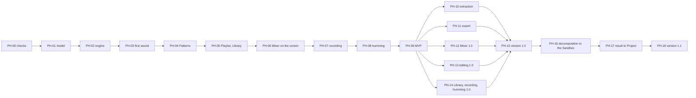

# development_roadmap.md

**Project:** mini daw, a compact DAW for Android phones. All sound comes from samples.
**Stage:** 5 of 6 (roadmap) · **Version:** 2.0 · **Date:** 2026-11-20
**Change in 1.1:** final check of Stage 6. The 22 new criteria of `feature_specifications.md` 1.2 have their tasks. The pointers to `opus_implementation_guide.md` name its sections. The run "Build" checks the size of the release build. Changed parts: Sections 2.1, 2.3, 2.6, 6.1, 6.3, 6.5 to 6.10, 6.13 to 6.15, 8.2, 9.1, 9.2 and 10.
**Change in 2.0:** version 1.1 adds the Decomposer (D-104). The implementer works on the computer of the owner (D-103). New parts: Section 3.5, the phases PH-16 to PH-18 (Sections 6.17 to 6.19) with the tasks TK-100 to TK-115, the gates GATE-16 to GATE-18, Section 7.4, the milestone M6. Changed parts: Sections 1.1, 1.2, 2.1, 2.3, 2.5, 2.7, 3.1, 3.4, 4.1, 4.2, 4.3, 6.1 (objectives, TK-014), 7.2, 8.1, 8.2, 9.1 and 10.
**Companion documents:** `requirements.md`, `technology_stack.md`, `architecture.md`, `feature_specifications.md`, `ui_ux_specification.md`, `risk_assessment.md`, `opus_implementation_guide.md` and `project_decisions.md` in their newest versions. IDs such as `FR-`, `NFR-`, `D-`, `V-`, `AC-`, `MT-` and `RISK-` point to them.

---

## How to read this document

Conventions:

1. Capitalized names are terms of `requirements.md` Section 2 and of `architecture.md` Section 1.3.
2. A phase has an ID of the form `PH-<number>`. A task has an ID of the form `TK-<number>`. A gate has an ID of the form `GATE-<number>`.
3. A gate is the set of conditions that ends a phase. The gate of a phase carries the number of the phase.
4. The order of the IDs is the order of the work. A task depends only on tasks with a smaller number.
5. "(prov.)" marks a provisional value.
6. This document plans the work. It claims no result of a check and no result of a test.
7. The decisions D-092 to D-096 of `project_decisions.md` record the main choices of this document.
8. Version 1.1 follows version 1.0. Section 3.5 describes it (D-104).

| Item that the brief asks for (§4 F and Stage 5) | Section |
|---|---|
| Logical development phases | 4, 6 |
| Objectives of each phase | 6 |
| Features to implement in each phase | 6 |
| Technical dependencies of each phase | 4.2, 6 |
| Implementation order | 1.2, 6 |
| Expected deliverables of each phase | 6 |
| Testing requirements of each phase | 2.3, 6, 8 |
| Definition of done of each phase | 2.6, 7 |
| The Mixer, coordinated with the audio engine and the Playlist | 5 |
| A sensible MVP, apart from the later stages | 3 |
| Dependencies | 4.2, 6 |
| Milestones | 4.3 |
| Acceptance criteria | 9 |

Each phase in Section 6 has one table. Its first seven rows are the seven items of the brief, in the order of the brief. An eighth row names the risks of `risk_assessment.md` to watch. A table of tasks follows.

---

## 1. Basis of the plan

### 1.1 Who does what

| Role | Who | Work |
|---|---|---|
| Implementer | Claude Opus | Writes code and tests. Runs every check of the host. Keeps the documents up to date. It cannot listen and cannot hold the phone (CON-17). It runs as Claude Code in VS Code on the computer of the owner, in a local copy of the repository (D-103). |
| Owner | The user of the app | Installs builds on the phone. Runs the checks and the manual tests. Judges sound and feel. Holds the accounts and the secrets. |
| CI service | GitHub Actions in the repository of the owner (D-073) | Builds the app. Runs the checks of the host and the tests on an emulator. Offers the builds for download. |

### 1.2 Principles of the order

1. **Checks first.** The checks V-01 to V-07 decide the Conditional decisions. They run before the code that depends on them (PH-00). The check V-08 does the same for version 1.1 in PH-16.
2. **Host before phone.** The implementer can verify work on a host by itself. A test on the phone needs a build of the CI service and the time of the owner. The model and the engine are therefore built and tested on the host first (PH-01, PH-02).
3. **A usable build per phase.** From PH-03 on, each phase ends with a build that lets the owner do something new.
4. **The Mixer grows with the engine and the Playlist.** Section 5 shows the steps.
5. **Uncertain parts early.** Startup, audio path, load of the engine, humming and the Sandbox are measured in PH-00.
6. **Nothing breaks silently.** Every task leaves all earlier criteria green. The CI service checks this on every change.
7. **The MVP needs no network and no account.** Extraction comes after the MVP (D-022).

### 1.3 Tasks and their sizes

A task is bounded. It has one goal, it names its modules, and it ends with conditions that a program or the owner can check.

| Size | Meaning |
|---|---|
| S | One part of one module with its tests |
| M | One module, or one flow through two modules |
| L | One flow through several modules. The implementer splits such a task into steps and records the steps before it starts. |

The column "Done when" of a table of tasks lists the acceptance criteria of `feature_specifications.md` that the task must meet. Section 2.6 adds the rules that hold for every task.

---

## 2. Workflow of development (D-073, D-094)

### 2.1 Places

| Place | Content |
|---|---|
| Repository | The code. The nine documents in the folder `docs/`. The script `checks/check_docs.py`. The results of checks and of manual tests in the folder `docs/results/`. The record of the work in the file `docs/progress.md` (D-098). |
| Computer of the owner | The local copy of the repository. The implementer works in it and sends each change to the repository (D-103). |
| CI service | The runs of Section 2.3 and the encrypted secrets |
| Page of releases of the repository | The builds for download (prov.; TK-002 confirms that this way works on the phone) |
| Phone | The test build and the release build |
| Claude Console | The API key and the limit of spending. Only extraction needs them. |

### 2.2 Kinds of builds

| Kind | Content | Use |
|---|---|---|
| Test build | The app, optimized like a release, with the screen "Measurements" (`ui_ux_specification.md` Section 15.4) | Checks and manual tests |
| Release build | The app without this screen | Daily use by the owner |

Rules:

1. The test build has its own application ID. It lives beside the release build and keeps its data apart. A measurement that clears data never touches the Projects of the owner.
2. All builds carry the same key for signing. An update therefore installs over the build before, and the Projects stay.
3. A manual run of the CI service creates this key once. The file of the key lies in the repository. A password protects it.
4. The password is an encrypted secret of the CI service. Only the owner sets it (task O-7).
5. No other key and no readable secret may enter the repository (NFR-SEC-01).
6. Each build shows its version and the ID of its change in the diagnostics view.

### 2.3 Runs of the CI service

| Run | Started | Content |
|---|---|---|
| Check | By every change | The one command (NFR-MNT-05). The list below names its parts. |
| Build | By every change of the main branch | Test build and release build. Both go to the page of releases. The run fails when the file of the release build is larger than 50 MB (AC-APP-20). |
| Emulator | By every change of the main branch (prov.) | Tests that need Android: import, stores, screens. Macrobenchmark, which also produces the profiles. |
| Key for signing | By the owner, once | Section 2.2 |
| Setup of the account | By the owner | The setup script, with the API key as an encrypted secret |
| Sandbox test | By the owner | The check V-06 |
| Quality of the separation | By hand, after a change of the model file or of the program `separate` | `feature_specifications.md` Section 5.8 |
| Decomposition test | By the owner | The Sandbox part of the check V-08 |
| Quality of the decomposition | By hand, after a change of the program `decompose`, of a model file or of the low register | `feature_specifications.md` Section 12.8 |

Parts of the one command:

1. The tests of the Kotlin code.
2. The tests of the C++ code and the render tests, with the sanitizers.
3. The tests of the Toolkit.
4. Static analysis for all three languages.
5. The check of the rules for dependencies.
6. The scan for secrets.
7. The check of the list of licences.
8. The check of the documents.

Rules:

1. The implementer runs the one command on its host before it sends a change (A-11). On the computer of the owner it runs the parts whose tools are present (A-23). The CI service runs the whole command. Its result is the one that counts.
2. A change enters the main branch only after a green run "Check".
3. The plan of the account limits the minutes of the CI service. Long runs therefore start only on the main branch (A-21).
4. The setup script and the Sandbox test can also run on any computer with Python. The API key then never reaches the CI service (D-073).
5. No run prints a secret into its log.
6. The implementer reads the result of a run with the GitHub CLI of the computer of the owner. Without this tool, the owner reports the result (A-23, task O-13).

### 2.4 From a change to the phone

1. The implementer sends a change to the repository.
2. The run "Check" passes.
3. The change enters the main branch.
4. The run "Build" places both builds on the page of releases.
5. The owner opens this page in the browser of the phone and downloads the build.
6. The owner installs it. Android asks once whether the browser may install apps (task O-8).

### 2.5 From the phone back to the implementer

1. The owner opens the screen "Measurements" of the test build.
2. The owner starts the measurements of the gate. Each one shows its result, its pass rule and the word "pass" or "fail".
3. For a test that the owner judges by ear or by eye, the screen holds a row. The owner marks it as passed or failed and can add a note.
4. One button shares all results as a file.
5. The owner hands the file to the implementer: in the session with the implementer, or as a file in the folder `docs/results/` of the local copy.
6. The implementer stores the file in `docs/results/` and records the gate.

### 2.6 Rules for every task

A task is done when all of these conditions hold:

1. The criteria in its column "Done when" pass.
2. The one command passes. No earlier criterion fails (NFR-MNT-05).
3. `engine-core` still builds and passes its tests on the host (NFR-MNT-01).
4. The check of the rules for dependencies passes (NFR-MNT-04).
5. Every new library stands in the list of licences (NFR-LEG-01).
6. The documents and the decision log are up to date. `opus_implementation_guide.md` Section 4.1 describes this step.

A criterion whose check is a manual test follows one more rule. The task ends when the build with the measurement is delivered. The criterion counts as passed at the gate of the phase.

### 2.7 Reviews before a release

| Review | When | Who | Requirement |
|---|---|---|---|
| Licences of all libraries | Automatic on every change. By hand at GATE-09, GATE-15 and GATE-18. | Implementer | NFR-LEG-01 |
| Terms of the factory Samples and of the model files; notice file | GATE-09 for the app. GATE-15 for the stem model. GATE-18 for the model file for the beats. | Implementer prepares, owner decides | NFR-LEG-02 |
| Usage policies and supported regions of the Claude API | GATE-10 | Owner | NFR-LEG-05 |
| Rules of Google Play | Only if the app is published there | Owner | NFR-LEG-04 |

---

## 3. MVP and later versions (D-092)

### 3.1 Border

Stage 5 confirms the border of D-022. P0 requirements form the MVP. P1 requirements form version 1.0. V1.1 requirements form version 1.1 (Section 3.5). P2 requirements come later.

| Area | MVP | Version 1.0 | Later |
|---|---|---|---|
| Workspace | Two panels, global bar, five Modules, Mixer over the panels | Module Extraction | — |
| Transport | Play, stop, Song mode, Pattern mode, tempo, metronome, 4/4 | Loop region, tempo by taps, more time signatures | — |
| Playlist | Tracks, both kinds of Clip, move, trim, duplicate, waveforms | Split, gain of a Clip, several Clips at once, solo and order of Tracks | Fades of a Clip |
| Patterns and Piano roll | Patterns with Parts, Notes, keys | Several Notes at once, velocity, quantize, copy and paste | Scales |
| Channel Rack | Step buttons, mute, volume | Pan, solo, order of rows, drag across Steps | Velocity per Step, swing |
| Sampler instruments | One Sample, Root note, two play modes | Envelope, loop, fine tuning | Kit instrument |
| Library | Groups, preview, import, factory set | Search, tags, favorites, sharing into the app, trim, normalize | — |
| Recording | Takes with two targets, place in time | Count-in, calibration, shortcuts of the launcher | Monitoring, stereo input |
| Humming to MIDI | Conversion on the phone into a new Pattern | Correction of the tuning, second run, any Sample | Tempo from the Take |
| Mixer | Channels by Track, fader, pan, mute, solo, meters, Master channel | Buses, own channel of a Sampler instrument | Sends, automation |
| Effects | Equalizer, delay, reverb | Compressor, limiter, saturation, filter, chorus | Presets |
| Projects | Autosave, undo, list of Projects | Archive of a Project | — |
| Export | None. The offline render exists as a test tool (D-021). | WAV, M4A, MIDI file | One file per channel |
| Extraction | None | The whole feature | — |

`feature_specifications.md` Section 10 lists the P2 requirements by ID.

### 3.2 Reasons for this border

1. The MVP holds two of the three core features and the Mixer. It covers the path from an idea to an arranged and mixed sketch.
2. The MVP works without a network and without an account.
3. Extraction has the most uncertainty. It depends on a beta service and on the check V-06 (D-028).
4. Export is small once the engine renders offline. It follows early in version 1.0.
5. Every P1 function builds on a part that the MVP already has. No P1 function changes the architecture.

### 3.3 What the owner can do with the MVP

1. Open the app and play a key at once.
2. Record a Take, or hum a melody and get Notes.
3. Enter beats with step buttons.
4. Arrange Audio clips and Pattern clips on up to 8 Tracks.
5. Mix with faders, pan, mute, solo and three effects.
6. Close the app at any moment without a loss.

### 3.4 After version 1.0

The P2 requirements have no phase. Three candidates for the first later version:

1. Playback and export while the app is in the background. This needs a foreground service (CON-08).
2. A hosted separation model with a GPU as one more tool of the Orchestrator (D-032). `technology_stack.md` Section 9.7 names the first candidate.
3. Sends in the Mixer (FR-MX-12).

### 3.5 Version 1.1: the Decomposer (D-104)

The owner asked for a second tool on 2026-11-20. Version 1.1 holds it. It follows version 1.0.

| Area | Version 1.1 | Later |
|---|---|---|
| Workspace | A second main screen, the Decomposer, with the Mode switch | — |
| Decomposer | Tempo, four stems, Notes for the drums and for the bass, a new Project | Six stems, Notes for chords, a model for the drum kit, the nearest Sample of the Library |
| Library | The group Decomposed | — |
| Humming to MIDI | The low register of the conversion | — |

Reasons for this place in the order:

1. The Decomposer needs the parts of extraction: the client, the Runner, the Toolkit and the setup (PH-10).
2. Its Notes of the bass need the conversion of any Sample (TK-097).
3. It adds no requirement of the brief. Version 1.0 therefore closes first.
4. The check V-08 measures its uncertain parts before its screen is built (D-112).

The owner can ask for another order (Q-18). The phases PH-16 and PH-17 need GATE-10 and the task TK-097. They need nothing else of version 1.0.

---

## 4. Overview of the phases

### 4.1 Table of the phases

| ID | Name | Goal | Version | Tasks |
|---|---|---|---|---|
| PH-00 | Workflow and checks | A change reaches the phone as a build. The seven checks have results. | Before the MVP | TK-001 to TK-014 |
| PH-01 | Model of a Project | State, Edits, document and compiler work on the host. | MVP | TK-015 to TK-020 |
| PH-02 | Engine on the host | The engine renders fixed Projects correctly, with Mixer and effects. | MVP | TK-021 to TK-026 |
| PH-03 | First sound on the phone | The workspace opens at once. A key and Play make sound. | MVP | TK-027 to TK-033 |
| PH-04 | Patterns | The owner writes Notes and beats. | MVP | TK-034 to TK-039 |
| PH-05 | Playlist and Library | The owner arranges Clips, imports audio and keeps several Projects. | MVP | TK-040 to TK-046 |
| PH-06 | Mixer on the screen | The owner mixes and sets effects. | MVP | TK-047 to TK-051 |
| PH-07 | Recording | The owner records Takes in time with the Project. | MVP | TK-052 to TK-055 |
| PH-08 | Humming to MIDI | A hummed Take becomes a Pattern. | MVP | TK-056 to TK-059 |
| PH-09 | Release of the MVP | The MVP meets its budgets on the phone. | MVP | TK-060 to TK-067 |
| PH-10 | Extraction | A described sound becomes a Sample. | 1.0 | TK-068 to TK-077 |
| PH-11 | Export and archive | A song leaves the app as a file. | 1.0 | TK-078 to TK-082 |
| PH-12 | Mixer of version 1.0 | Buses and five more effects. | 1.0 | TK-083 to TK-087 |
| PH-13 | Editing of version 1.0 | Deeper tools for Transport, Clips, Notes and Sampler instruments. | 1.0 | TK-088 to TK-092 |
| PH-14 | Library, recording and humming of version 1.0 | The P1 functions of these three parts. | 1.0 | TK-093 to TK-097 |
| PH-15 | Release of version 1.0 | Version 1.0 passes every manual test. | 1.0 | TK-098 to TK-099 |
| PH-16 | Decomposition in the Sandbox | The Toolkit turns a range into a tempo, stems and Hit groups. The check V-08 has results. | 1.1 | TK-100 to TK-105 |
| PH-17 | From a result to a Project | A result of the Toolkit becomes a Project on the host. | 1.1 | TK-106 to TK-110 |
| PH-18 | Decomposer and release of version 1.1 | The owner decomposes a recording on the phone. | 1.1 | TK-111 to TK-115 |

### 4.2 Dependencies between the phases

In words: PH-00 to PH-09 follow each other. PH-10 to PH-14 each need only the MVP. PH-15 needs all of them. PH-16 to PH-18 follow PH-15 and each other.

Rules:

1. The phases PH-10 to PH-14 do not depend on each other. The owner can change their order. One task is an exception: TK-094 needs TK-071.
2. The planned order puts extraction first, because it is the third core feature of the brief.
3. Each table of tasks in Section 6 names the tasks that a task needs.
4. PH-16 and PH-17 need only GATE-10 and TK-097 from version 1.0. The owner can therefore move them forward (Q-18). PH-18 ends with the release of version 1.1 and needs GATE-15.

### 4.3 Milestones

| Milestone | Reached at | What it means |
|---|---|---|
| M0: basis confirmed | GATE-00 | The stack and the main budgets rest on measurements of the phone. |
| M1: first sound | GATE-03 | The chain from an Edit to the speaker works on the phone. |
| M2: sketch without microphone | GATE-06 | The owner can write, arrange and mix with Samples. |
| M3: MVP | GATE-09 | The MVP is released for daily use. |
| M4: third core feature | GATE-10 | Extraction works with the account of the owner. |
| M5: version 1.0 | GATE-15 | All P0 and P1 requirements are met. |
| M6: version 1.1 | GATE-18 | The Decomposer turns a recording into a Project on the phone. |

---

## 5. How the Mixer grows with the engine and the Playlist

The Mixer is no separate project. Each step below builds a part of the engine, a part of the model or of the Playlist, and the matching part of the Mixer.

| Step | Phase | Engine | Model and Playlist | Mixer |
|---|---|---|---|---|
| 1 | PH-00 | Kernels of three effects are measured (V-04) | — | The cost of the effects is known before the engine is built |
| 2 | PH-01 | Format of a Snapshot with channels, Effect slots and order | An Edit that adds a Track also adds its Mixer channel (FR-MX-02) | Model of the Mixer, flags "audible", document |
| 3 | PH-02 | Render function with sources per Track | Fixtures with Tracks and Clips | Stations of a channel, Master channel, meters, three effects. All tested on the host. |
| 4 | PH-03 | Output stream and telemetry | A new Project with one Track and one channel | Levels and flags reach the telemetry |
| 5 | PH-05 | Streamers for long audio | Playlist with headers of Tracks: mute and the name of the channel | A Track shows its channel |
| 6 | PH-06 | Live commands for faders and parameters | A selected Track marks its Strip | The Mixer on the screen: Strips, Channel page, Effect editor |
| 7 | PH-12 | Order of processing with buses | A Sampler instrument with an own channel | Buses and five more effects |

Rules that keep the three parts in step:

1. One render function runs the Sequencer and the Mixer for the same block (D-063).
2. One Snapshot holds Tracks, Clips and channels. A swap changes all of them at the same frame (D-062).
3. No effect adds latency (FR-FX-09). The Mixer therefore needs no correction of delays.
4. Song mode, Pattern mode and the offline render use the same path through the Mixer (FR-MX-14).
5. The criteria of the Mixer in the engine (TK-024, TK-025) pass before any screen of the Mixer exists.

---

## 6. Phases in detail

Columns of a table of tasks:

1. "Needs" names the tasks that must be done before.
2. "Size" follows Section 1.3.
3. "Done when" names the criteria of the task. Section 2.6 adds the rules for every task.

### 6.1 PH-00: workflow and checks

| Item | Content |
|---|---|
| Objectives | A change in the repository reaches the phone as a build. Each check V-01 to V-07 has a recorded result. Each Conditional decision that rests on one of these checks is confirmed or replaced. |
| Features to implement | No feature of the product. Three small apps for the checks. First versions of four parts that later phases use again. The list below the tasks names them. |
| Technical dependencies | An empty repository (task O-6). The password of the key for signing (task O-7). For V-05: 10 melodies of the owner (task O-5). For V-06: a new API key (task O-1). |
| Implementation order | TK-001 to TK-003 come first, because no test build exists without them. All other tasks are the checks. TK-014 closes the phase. |
| Expected deliverables | The repository with the documents, the one command and the runs of the CI service. One file of results per check. An updated `project_decisions.md`. |
| Testing requirements | The one command passes. The tests of the kernels, of the code for Notes and of the Toolkit pass on the host. The owner runs the parts on the phone. |
| Definition of done | GATE-00 |
| Risks to watch | RISK-01, RISK-02, RISK-04 to RISK-09, RISK-12 to RISK-15, RISK-17, RISK-18, RISK-20, RISK-22 |

| ID | Task | Modules | Needs | Size | Done when |
|---|---|---|---|---|---|
| TK-001 | Repository, modules and the one command | All folders | — | M | The one command runs on the host and in the CI service. It holds the checks of NFR-MNT-01, NFR-MNT-04 and NFR-MNT-05. AC-APP-18 passes. |
| TK-002 | CI service, key for signing, delivery of builds | CI service | TK-001 | M | The owner installed a test build from a download and shared a file of results (NFR-MNT-06). AC-APP-20 passes. |
| TK-003 | Check V-01: facts of the phone | App for the checks | TK-002 | S | The nine values of `requirements.md` Section 3.2 are recorded. |
| TK-004 | Check V-02: floor of the startup | Two empty apps and a prototype of the workspace | TK-002 | M | The values of `technology_stack.md` Section 6.1 are recorded. The file also says whether a build from a download runs with its profile. |
| TK-005 | Check V-03: audio path | App for the checks, glue for Oboe | TK-002 | M | Rate, Burst, kind of path, Underruns over 10 min and the times to open both streams are recorded. |
| TK-006 | Check V-07: latency of a Take | App for the checks | TK-005 | S | The offset from the timestamps and the offset from the loopback are recorded, for the speaker and for wired headphones. |
| TK-007 | Check V-04: load of the engine | `engine-core`, `:engine-api` | TK-002 | M | The load of the Voices and of the effects is recorded on the phone, for the counts of both standard test Projects. The times of a compile and of a load are recorded for a prototype. |
| TK-008 | Pitch candidates and code for Notes | Native code of `:analysis` | TK-001 | L | AC-H2M-01, AC-H2M-10, AC-H2M-13 |
| TK-009 | Evaluation of both candidates on the public set | Tools of `:analysis` on the host | TK-008 | S | A report gives the F-measure of both candidates (NFR-QLT-01). |
| TK-010 | Check V-05: humming on the phone | App for the checks | TK-005, TK-007, TK-008 | M | The owner hummed 10 melodies. The count of corrections and the time are recorded for each candidate. The rule of `technology_stack.md` Section 8.2 names the winner. |
| TK-011 | Toolkit, first version | `toolkit/` | TK-001 | L | AC-AIX-09 |
| TK-012 | Setup script and test script of the Sandbox | `setup/` | TK-011 | M | AC-AIX-18 |
| TK-013 | Check V-06: Sandbox | `setup/`, manual runs | TK-012 | S | The values of `technology_stack.md` Section 9.6 are recorded for 10 Sessions. The owner judged three results. |
| TK-014 | Review of the provisional values and of the Conditional decisions | Documents | TK-003 to TK-013 | S | Each check has its file of results. Each Conditional decision that rests on one of these checks has its new status. The limits and the sizes are reviewed. |

Parts that later phases use again:

1. The inner loops of the Voice and of three effects (TK-007).
2. The code for Notes with both pitch candidates (TK-008).
3. The Toolkit (TK-011).
4. The setup script (TK-012).

How three checks can run this early (D-095):

1. V-04 measures kernels and a prototype. The kernels are the inner loops of the Voice and of the three effects. The prototype writes and loads a Snapshot with the counts of the standard test Project of version 1.0. PH-01 and PH-02 turn both into the real code.
2. V-05 needs no editor. The app for the checks records a melody, runs both candidates and plays both results with the default tone. It also shows the Notes as a picture. The owner counts the Notes that are wrong.
3. V-06 needs the Toolkit and the setup script. Both are built here in a first version. PH-10 finishes them.

The recordings of the owner stay on the phone. The file of results holds numbers and verdicts. The owner decides whether to share the audio as well (NFR-SEC-03).

### 6.2 PH-01: model of a Project

| Item | Content |
|---|---|
| Objectives | The state of a Project, its Edits and its document exist in `:core`. The compiler turns a state into a Snapshot. Everything is tested on the host. |
| Features to implement | Edits and rules of `feature_specifications.md` Sections 2.2.1, 2.2.2 and 3.4. Undo and redo (FR-PRJ-04). Flags "audible" (Section 3.2.3 of `feature_specifications.md`). Document and Snapshot (`feature_specifications.md` Sections 6.1 and 6.2). |
| Technical dependencies | GATE-00. The prototype of TK-007. D-059, D-061, D-062. |
| Implementation order | TK-015 to TK-020 in the order of their IDs. |
| Expected deliverables | The modules `:engine-api` and `:core` with their tests. Fixtures: documents of small Projects with their expected Snapshots. |
| Testing requirements | The Reducer with random Edits. Undo and redo. Writing and reading of the document. The compiler with fixed Projects (`architecture.md` Section 15). |
| Definition of done | GATE-01 |
| Risks to watch | RISK-13, RISK-16 |

| ID | Task | Modules | Needs | Size | Done when |
|---|---|---|---|---|---|
| TK-015 | Types of the engine: Live commands, telemetry, writer of a Snapshot, fake engine | `:engine-api` | TK-007 | S | The writer gives the bytes of `feature_specifications.md` Section 6.2 for fixed inputs. |
| TK-016 | State, Edits and Reducer of Tracks, Clips, Patterns, Parts, Notes and Sampler instruments | `:core` | TK-015 | L | AC-PL-01, AC-PL-02, AC-PL-11, AC-PT-02, AC-PT-05, AC-CR-01, AC-TR-09 |
| TK-017 | Undo, redo and `ProjectSession` | `:core` | TK-016 | S | AC-PL-06, AC-PRJ-07 |
| TK-018 | Mixer in the model: channels, assignment, volume, pan, mute, solo, Effect slots, flags "audible" | `:core` | TK-016 | M | AC-MX-04 |
| TK-019 | Document of a Project: writing, reading, defaults, migration | `:core` | TK-018 | M | AC-PRJ-09, AC-PRJ-10, AC-MX-11, AC-FX-08 |
| TK-020 | Compiler and chain of the fixtures | `:core`, build | TK-018 | M | Fixed Projects give the expected Snapshots. A task of the build compiles every fixture. |

### 6.3 PH-02: engine on the host

| Item | Content |
|---|---|
| Objectives | `engine-core` renders every fixture correctly on the host. The Mixer and the three effects of the MVP are part of it. |
| Features to implement | Render function, Voices and Sequencer (`feature_specifications.md` Sections 2.2.4 and 2.2.5). Mixer, effects, metronome and the path of the preview (`feature_specifications.md` Sections 3.2 and 3.10). The structure follows `architecture.md` Section 5. |
| Technical dependencies | GATE-01. The kernels of TK-007. The result of V-04 for D-038. |
| Implementation order | TK-021 to TK-026. The Voices come before the Sequencer, because the Sequencer starts them. The Mixer comes after both, because it needs their sources. |
| Expected deliverables | The library `engine-core` for the host and for the phone. Render tests for every fixture. A program that renders a Project offline (D-021). |
| Testing requirements | Render tests: places of events, levels, silence, sudden steps, spectra. Random Live commands and swaps. The sanitizers on every run (D-050). Two renders of one Snapshot are equal bit for bit (NFR-AUD-11). |
| Definition of done | GATE-02 |
| Risks to watch | RISK-02, RISK-03, RISK-04, RISK-06, RISK-12, RISK-16 |

| ID | Task | Modules | Needs | Size | Done when |
|---|---|---|---|---|---|
| TK-021 | Loader and checker of a Snapshot, render function, swap, Live commands | `engine-core` | TK-020 | M | A broken Snapshot is refused. Random Live commands and swaps cause no crash and no invalid number. |
| TK-022 | Voices: interpolation with copies, play modes, velocity, fades, limits | `engine-core` | TK-021 | M | AC-SM-01 to AC-SM-07 |
| TK-023 | Sequencer: Song mode, Pattern mode, tempo, end of the song, move of the playhead | `engine-core` | TK-022 | L | AC-TR-01 to AC-TR-05, AC-TR-08, AC-PL-03, AC-PL-04, AC-PL-07, AC-PL-12, AC-PT-01, AC-PT-03 |
| TK-024 | Mixer in the engine: sum, fader, pan, flags, Master channel, meters, metronome, preview | `engine-core` | TK-023 | L | AC-MX-01 to AC-MX-03, AC-MX-05 to AC-MX-10, AC-MX-12, AC-MX-19, AC-TR-06, AC-CR-04, AC-LIB-04 |
| TK-025 | Effects: pipeline of an effect, equalizer, delay, reverb, tails | `engine-core` | TK-024 | L | AC-FX-01 to AC-FX-07, AC-FX-09 to AC-FX-11, AC-FX-13, AC-APP-15 |
| TK-026 | Rules of the audio thread and equal renders | `engine-core`, CI service | TK-025 | S | AC-APP-06, AC-APP-21 |

### 6.4 PH-03: first sound on the phone

| Item | Content |
|---|---|
| Objectives | The app opens the workspace at once. A tap on a key and the Play control make sound on the phone. A Project survives the end of the process. |
| Features to implement | Startup and shell of the workspace (FR-WS-01 to FR-WS-04, FR-WS-07, FR-WS-10, FR-WS-11). Transport with metronome (FR-TR-01 to FR-TR-04, FR-TR-09, FR-TR-10). Autosave and recovery (FR-PRJ-01 to FR-PRJ-03). Factory set (FR-LIB-07). Diagnostics view (FR-SET-01). |
| Technical dependencies | GATE-02. The result of V-02: a shell with Compose or with Views (D-041). The result of V-03: the values of the streams (D-035). D-042, D-067, D-068. |
| Implementation order | TK-027 to TK-033. The engine and the stores come before the shell, because the startup wires them together. |
| Expected deliverables | The first build of the real app, as a test build and as a release build. The measurements "Startup", "Tap" and "Engine". |
| Testing requirements | Tests of the stores with a kill at random moments, on the emulator. Tests of the shell. The manual tests of GATE-03. |
| Definition of done | GATE-03 |
| Risks to watch | RISK-01, RISK-14, RISK-15, RISK-16, RISK-19, RISK-20, RISK-22 |

| ID | Task | Modules | Needs | Size | Done when |
|---|---|---|---|---|---|
| TK-027 | Factory set: script, files, manifest, check of the build | Tools of the build, `:app` | TK-001 | S | AC-FS-01 to AC-FS-03, AC-FS-07 |
| TK-028 | Engine on Android: output stream, Control thread, bridge, telemetry, idle state, audio focus, Underruns | `:engine` | TK-026, TK-005 | L | AC-APP-07, AC-APP-09, AC-APP-11, AC-APP-14 |
| TK-029 | Store of Projects with autosave and recovery; store of the settings | `:data` | TK-019 | M | AC-PRJ-02 to AC-PRJ-05 |
| TK-030 | Library, step 1: index, factory set at the first launch | `:data` | TK-027, TK-029 | S | AC-LIB-05 |
| TK-031 | Shell of the workspace: startup, wiring, global bar, panels, Border, swap, Module strip, saved layout, full screen, theme | `:app`, `:ui:workspace`, `:ui:kit` | TK-017, TK-028, TK-030 | L | AC-WS-01 to AC-WS-03, AC-WS-05, AC-WS-08 to AC-WS-10, AC-WS-13, AC-APP-03, AC-PRJ-01 |
| TK-032 | Transport and first sound: Play, Stop, modes, tempo, metronome, playhead, keys of the Piano roll | `:ui:workspace`, `:ui:editors` | TK-031 | M | AC-FS-04, AC-PT-04, AC-TR-07 |
| TK-033 | Settings and diagnostics view; measurements "Startup", "Tap" and "Engine" | `:ui:workspace`, test build | TK-032 | M | AC-WS-15 |

### 6.5 PH-04: Patterns

| Item | Content |
|---|---|
| Objectives | The owner writes Notes in the Piano roll and beats in the Channel Rack. Pattern mode plays them. Every Edit can be undone. |
| Features to implement | Piano roll (FR-PT-01 to FR-PT-08; `ui_ux_specification.md` Section 6). Channel Rack (FR-CR-01 to FR-CR-05, FR-CR-09 to FR-CR-12; `ui_ux_specification.md` Section 7). Sample browser with preview and with its mode for choosing (FR-LIB-01 to FR-LIB-03). A Sampler instrument from a Sample (FR-SM-02, FR-SM-03). |
| Technical dependencies | GATE-03. D-041, D-079. |
| Implementation order | TK-034 to TK-039. The Piano roll comes first, because a new Project opens it (D-080). The Sample browser comes before the Channel Rack, because a new Part needs a Sample. |
| Expected deliverables | A build in which the owner writes and plays Patterns. The measurement "Edit". |
| Testing requirements | Tests of geometry, of hit tests and of recorded gestures on the host (`ui_ux_specification.md` Section 17). One test per row of the tables of gestures. The manual tests of GATE-04. |
| Definition of done | GATE-04 |
| Risks to watch | RISK-13, RISK-20 |

| ID | Task | Modules | Needs | Size | Done when |
|---|---|---|---|---|---|
| TK-034 | Piano roll: drawing, scroll, zoom, hit tests | `:ui:editors` | TK-032 | M | The tests of the geometry and of the hit tests pass. |
| TK-035 | Piano roll: gestures and Edits of Notes, Pencil, selection, grid | `:ui:editors` | TK-034 | L | AC-PT-06, AC-PT-10 |
| TK-036 | Sample browser, step 1: groups, rows, preview, mode for choosing, "use as Sampler instrument" | `:ui:library` | TK-030, TK-032 | M | AC-SM-08, AC-LIB-10 |
| TK-037 | Patterns and Parts: Pattern bar, list of Patterns, length, Parts, settings of a Sampler instrument | `:ui:editors` | TK-035, TK-036 | M | AC-PT-08, AC-PT-11 |
| TK-038 | Channel Rack: rows, step buttons, mute, volume, lit Step, picture of a Part | `:ui:editors` | TK-037 | L | AC-CR-02, AC-CR-03, AC-CR-05 to AC-CR-09 |
| TK-039 | Undo, redo and Hints in the workspace; measurement "Edit" | `:ui:workspace`, test build | TK-035 | S | AC-PL-05 |

### 6.6 PH-05: Playlist and Library

| Item | Content |
|---|---|
| Objectives | The owner arranges Audio clips and Pattern clips on Tracks. The owner imports audio files. The owner keeps several Projects. |
| Features to implement | Playlist (FR-PL-01 to FR-PL-13; `ui_ux_specification.md` Section 4). Grid and playhead (FR-TR-07, FR-TR-08). Import and the rest of the Sample browser (FR-LIB-04 to FR-LIB-06). Long audio from storage (NFR-RES-02). List of Projects (FR-PRJ-05). |
| Technical dependencies | GATE-04. D-037, D-065, D-069. |
| Implementation order | TK-040 to TK-046. The import comes before the Streamers, because it writes the files that they read. |
| Expected deliverables | A build in which the owner arranges a song. The measurements "Frames" and "Memory". The standard test Project as a fixture of the test build. |
| Testing requirements | Tests of the Playlist as in PH-04. The import of each format, on the emulator. The Streamers with ThreadSanitizer. The early runs of GATE-05. |
| Definition of done | GATE-05 |
| Risks to watch | RISK-02, RISK-05, RISK-19, RISK-20 |

| ID | Task | Modules | Needs | Size | Done when |
|---|---|---|---|---|---|
| TK-040 | Playlist: drawing, scroll, zoom, headers of Tracks, Ruler, waveforms | `:ui:editors` | TK-039 | L | AC-PL-14, AC-PL-15 |
| TK-041 | Playlist: gestures and Edits of Clips and Tracks, playhead, grid, Song mode | `:ui:editors` | TK-040 | L | AC-PL-08, AC-PL-13, AC-TR-10, AC-TR-11, AC-PT-07 |
| TK-042 | Import: decoding, conversion of the rate, files of the Library, peaks, copies, hash | `:data`, `engine-core` | TK-030 | L | AC-LIB-01, AC-LIB-02 |
| TK-043 | Long audio: Streamers, reader thread, cap of the memory | `engine-core`, `:engine` | TK-028, TK-042 | M | AC-APP-05 |
| TK-044 | Sample browser, step 2: import, rename, delete, Samples in use, missing Samples | `:ui:library`, `:data` | TK-036, TK-042 | M | AC-LIB-03, AC-LIB-06, AC-LIB-11, AC-PL-10, AC-FS-05 |
| TK-045 | Projects: menu, list, new, open, rename, duplicate, delete | `:ui:workspace`, `:data` | TK-031 | M | AC-PRJ-06, AC-PRJ-08, AC-WS-14 |
| TK-046 | Measurements "Frames" and "Memory"; standard test Project in the test build | Test build | TK-041, TK-043 | S | Both measurements run and show a result. |

### 6.7 PH-06: Mixer on the screen

| Item | Content |
|---|---|
| Objectives | The owner opens the Mixer with one tap, mixes, and sets the three effects. |
| Features to implement | The Mixer over the panels, with Strips and Channel page (FR-MX-04, FR-MX-07, FR-MX-08, FR-MX-13, FR-MX-16; `ui_ux_specification.md` Section 10). Effect editor (FR-FX-05 to FR-FX-07; `ui_ux_specification.md` Section 11). Panels that follow each other (FR-WS-08, FR-WS-09). |
| Technical dependencies | GATE-05. The Mixer of the engine from TK-024 and TK-025. D-077, D-078. |
| Implementation order | TK-047 to TK-051. The shared controls come first. |
| Expected deliverables | A build in which the owner mixes a song. |
| Testing requirements | Tests of the controls and of their Live commands on the host. The manual tests of GATE-06, by ear and by eye. |
| Definition of done | GATE-06 |
| Risks to watch | RISK-03, RISK-04, RISK-16, RISK-20 |

| ID | Task | Modules | Needs | Size | Done when |
|---|---|---|---|---|---|
| TK-047 | Shared controls: fader with meter, knob, switch; Live commands during a drag | `:ui:kit` | TK-031 | M | A drag sends Live commands. One Edit follows when the finger lifts. |
| TK-048 | Mixer over the panels: sizes Half and Full, Strips, Master strip, selection that follows | `:ui:mixer`, `:ui:workspace` | TK-047, TK-041 | L | AC-WS-06, AC-MX-18 |
| TK-049 | Channel page: Effect slots, Tracks of the channel, new and deleted channels, assignment of Tracks | `:ui:mixer` | TK-048 | M | AC-MX-20, AC-MX-21 |
| TK-050 | Effect editor: equalizer, delay and reverb, in the Module and in the Mixer | `:ui:mixer` | TK-049 | M | AC-FX-14, AC-FX-15, AC-WS-07, AC-MX-15 |
| TK-051 | Meters and clip indicators on the screen | `:ui:mixer` | TK-048 | S | AC-MX-14 |

### 6.8 PH-07: recording

| Item | Content |
|---|---|
| Objectives | The owner records a Take with one tap. The Take lies in time with the Project. No Take is lost. |
| Features to implement | Recording (FR-REC-01 to FR-REC-07; `feature_specifications.md` Sections 4.2.1 and 4.2.2; `ui_ux_specification.md` Section 9). |
| Technical dependencies | GATE-06. The results of V-03 and V-07 (D-040). The Streamers of TK-043. |
| Implementation order | TK-052 to TK-055 in the order of their IDs. |
| Expected deliverables | A build that records. The measurements "Record" and "Loopback". |
| Testing requirements | Tests with a fake input on the host. A kill during a Take, on the emulator. The manual tests of GATE-07. |
| Definition of done | GATE-07 |
| Risks to watch | RISK-01, RISK-11, RISK-19 |

| ID | Task | Modules | Needs | Size | Done when |
|---|---|---|---|---|---|
| TK-052 | Input stream, ring buffer of a Take, writer thread, file of a Take, repair after a crash | `:engine`, `engine-core`, `:data` | TK-043, TK-006 | L | AC-REC-02, AC-REC-03, AC-REC-07, AC-REC-08, AC-REC-11 |
| TK-053 | Place of a Take in time; Edit that adds a Take | `engine-core`, `:core` | TK-052 | M | AC-REC-05, AC-REC-10 |
| TK-054 | Recorder and Record control: targets, level, time, warnings, permission, ends of a Take, free storage | `:ui:library`, `:ui:workspace` | TK-053, TK-047 | M | AC-REC-06, AC-REC-09, AC-REC-15 to AC-REC-17, AC-APP-08 |
| TK-055 | Measurements "Record" and "Loopback" | Test build | TK-054 | S | AC-REC-01, AC-REC-04 |

### 6.9 PH-08: humming to MIDI

| Item | Content |
|---|---|
| Objectives | A hummed Take becomes a Pattern that the owner can play and edit at once. |
| Features to implement | Conversion (FR-H2M-01 to FR-H2M-08; `feature_specifications.md` Sections 4.2.3 to 4.2.6). |
| Technical dependencies | GATE-07. The winner of V-05 (D-044). The code of TK-008. |
| Implementation order | TK-056 to TK-059 in the order of their IDs. |
| Expected deliverables | A build that converts humming. The measurement "Humming". |
| Testing requirements | The code for Notes with the test melodies. The mapping to Ticks. The manual test of GATE-08. |
| Definition of done | GATE-08 |
| Risks to watch | RISK-07 |

| ID | Task | Modules | Needs | Size | Done when |
|---|---|---|---|---|---|
| TK-056 | Analysis in the app: native library with the winner of V-05, cache of the pitch, progress, cancel | `:analysis` | TK-010, TK-052 | M | AC-H2M-03, AC-H2M-06 |
| TK-057 | From Notes to the Project: Ticks, quantization, velocity, Edit that adds the Pattern | `:core` | TK-056 | M | AC-H2M-07 to AC-H2M-09 |
| TK-058 | Target "Humming" of the Recorder: flow, message without Notes, opening of the Piano roll | `:ui:library` | TK-057, TK-054 | S | AC-H2M-02, AC-H2M-16 |
| TK-059 | Measurement "Humming"; tuning of the start values | Test build, `:analysis` | TK-058 | S | AC-H2M-04, AC-H2M-05 |

### 6.10 PH-09: release of the MVP

| Item | Content |
|---|---|
| Objectives | The MVP meets its budgets on the phone: startup, frame timing, load and memory. The owner accepts it for daily use. |
| Features to implement | No new feature. Profiles for the startup (D-042). Page of licences (FR-SET-02). Rules for backup (NFR-SEC-07). The fixes that the measurements ask for. |
| Technical dependencies | GATE-08. The early runs of GATE-03 and GATE-05. |
| Implementation order | TK-060 to TK-067. The measurements come first. The fixes follow. The release comes last. |
| Expected deliverables | The release build of the MVP. The results of all manual tests of the MVP. A list of the known limits. |
| Testing requirements | All manual tests of GATE-09. The long run with random Edits. All criteria of the MVP in the CI service. |
| Definition of done | GATE-09 |
| Risks to watch | RISK-02, RISK-05, RISK-06, RISK-10, RISK-12, RISK-14, RISK-16, RISK-19, RISK-20, RISK-21 |

| ID | Task | Modules | Needs | Size | Done when |
|---|---|---|---|---|---|
| TK-060 | Startup: profiles from the emulator of the CI service; final measurement | `:benchmark`, CI service | TK-059 | M | AC-APP-01, AC-APP-02 |
| TK-061 | Frame timing and memory: fixes after the measurements | `:ui:editors`, `:data` | TK-046, TK-059 | M | AC-PL-09, AC-APP-04 |
| TK-062 | Load and long runs: standard test Project for 10 min and 30 min; long run with random Edits | Test build, `:engine` | TK-046, TK-059 | M | AC-MX-13, AC-APP-12, AC-PRJ-11 |
| TK-063 | Workspace: final pass over Modules, counts of taps, edges and answers to touches | `:ui:workspace` | TK-059 | S | AC-WS-04, AC-WS-11, AC-WS-12, AC-APP-19 |
| TK-064 | Audio devices, audio focus and work without a network | `:engine`, `:app` | TK-059 | S | AC-APP-10, AC-APP-13 |
| TK-065 | Manifest, rules for backup, page of licences, notice file | `:app` | TK-059 | S | AC-APP-16, AC-APP-17, AC-FS-06 |
| TK-066 | Sounds of the factory set after the judgment of the owner | Tools of the build | TK-036 | S | AC-FS-08 |
| TK-067 | Release of the MVP: release build, documents, list of the known limits | Documents, CI service | TK-060 to TK-066 | S | GATE-09 is passed. |

### 6.11 PH-10: extraction

| Item | Content |
|---|---|
| Objectives | The owner describes a sound in a recording and gets it as a Sample. Cost and time stay inside the limits. |
| Features to implement | Extraction (FR-AIX-01 to FR-AIX-17, FR-AIX-19, FR-AIX-20; `feature_specifications.md` Section 5; `ui_ux_specification.md` Section 12). Settings of the extraction (FR-SET-04). |
| Technical dependencies | GATE-09. The result of V-06 (D-028, D-046, D-047, D-088). The Toolkit of TK-011 and the setup script of TK-012. A valid API key (task O-1). |
| Implementation order | TK-068 to TK-077. The parts without a screen come first. They are tested against a fake of the API. |
| Expected deliverables | The module `:extraction`. The final Toolkit and the final setup script. A build with the Module Extraction. |
| Testing requirements | The Runner against a fake `ClaudeApi`, with a stop after every state. Hostile reports. The tests of the Toolkit. The measured quality of the separation. The manual test of GATE-10 with the real service. |
| Definition of done | GATE-10 |
| Risks to watch | RISK-08, RISK-09, RISK-10, RISK-11, RISK-17, RISK-18 |

| ID | Task | Modules | Needs | Size | Done when |
|---|---|---|---|---|---|
| TK-068 | Toolkit, final version; measured quality of the separation | `toolkit/` | TK-013, TK-067 | M | AC-AIX-10 |
| TK-069 | Store for the secret; settings of the extraction | `:data`, `:ui:workspace` | TK-067 | M | AC-AIX-13, AC-AIX-25 |
| TK-070 | Client of the Claude API and its fake; rules for the network | `:extraction` | TK-013, TK-067 | M | AC-AIX-17 |
| TK-071 | Source and cut: reader of sources, rules for links, cut of the range, "listen" | `:extraction`, `:data` | TK-067 | M | AC-AIX-01 to AC-AIX-03, AC-AIX-21 |
| TK-072 | Runner: states of a job, store of jobs, cleaning of the account, causes of a failure, ledger | `:extraction` | TK-069 to TK-071 | L | AC-AIX-04, AC-AIX-06, AC-AIX-07, AC-AIX-12, AC-AIX-20 |
| TK-073 | Reading of the report and of the candidates | `:extraction` | TK-072 | S | AC-AIX-08, AC-AIX-22 |
| TK-074 | Work outside the foreground: WorkManager and notifications | `:extraction`, `:app` | TK-072 | M | AC-AIX-05 |
| TK-075 | Module Extraction: pages "New" and "Jobs", blocking states, notice about the rights, quick mode | `:ui:library` | TK-072 | L | AC-AIX-14, AC-AIX-15, AC-AIX-19 |
| TK-076 | Review and acceptance: candidates, trim, group Extracted, the two actions | `:ui:library`, `:data` | TK-073, TK-075 | M | AC-AIX-11, AC-AIX-23 |
| TK-077 | Setup on the account for the release; manual test with the real service | `setup/`, manual runs | TK-068, TK-074, TK-076 | S | AC-AIX-16, AC-AIX-24 |

### 6.12 PH-11: export and archive

| Item | Content |
|---|---|
| Objectives | A song leaves the app as an audio file. A Pattern leaves it as a MIDI file. A Project moves as one archive. |
| Features to implement | Export (FR-EXP-01 to FR-EXP-04; `feature_specifications.md` Sections 8.2 and 8.3). Archive (FR-PRJ-07; `feature_specifications.md` Section 8.4). |
| Technical dependencies | GATE-09. The offline render of PH-02 (D-066). |
| Implementation order | TK-078 to TK-082 in the order of their IDs. |
| Expected deliverables | A build with the sheet "Export". |
| Testing requirements | The export against the render of the tests. Decoding of the M4A file, on the emulator. An independent reader for the MIDI file. Hostile archives. The manual test of GATE-11. |
| Definition of done | GATE-11 |
| Risks to watch | RISK-11, RISK-19 |

| ID | Task | Modules | Needs | Size | Done when |
|---|---|---|---|---|---|
| TK-078 | Export of the song as WAV: second engine, three formats, dither, count of limited frames, tails | `:engine`, `engine-core`, `:data` | TK-067 | M | AC-EXP-01 to AC-EXP-04, AC-EXP-08 |
| TK-079 | Export of the song as M4A | `:data` | TK-078 | S | AC-EXP-05 |
| TK-080 | MIDI file of a Pattern | `:core` | TK-067 | S | AC-EXP-06 |
| TK-081 | Sheet "Export", "Save to", "Share"; measurement of the speed | `:ui:workspace`, `:data`, test build | TK-079, TK-080 | M | AC-EXP-07, AC-EXP-09 |
| TK-082 | Archive of a Project: export and import | `:data`, `:core` | TK-067 | M | AC-PRJ-12 |

### 6.13 PH-12: Mixer of version 1.0

| Item | Content |
|---|---|
| Objectives | The Mixer routes channels into buses. Five more effects exist. The limits of version 1.0 hold on the phone. |
| Features to implement | Buses (FR-MX-11). Own channel of a Sampler instrument (FR-MX-19). More effects (FR-FX-03, FR-FX-10). New order of the effects of a channel (the P1 part of FR-MX-09). Limits of version 1.0 (`requirements.md` Section 8). |
| Technical dependencies | GATE-09. D-083, D-084. |
| Implementation order | TK-083 to TK-087 in the order of their IDs. |
| Expected deliverables | A build with buses and eight effects. The standard test Project of version 1.0. |
| Testing requirements | Render tests of the routing and of each new effect. The manual tests of GATE-12. |
| Definition of done | GATE-12 |
| Risks to watch | RISK-02, RISK-03, RISK-04 |

| ID | Task | Modules | Needs | Size | Done when |
|---|---|---|---|---|---|
| TK-083 | Routing with buses: targets, order of processing, check for loops, solo path | `:core`, `engine-core`, `:ui:mixer` | TK-067 | L | AC-MX-16 |
| TK-084 | Own Mixer channel of a Sampler instrument | `:core`, `engine-core`, `:ui:editors` | TK-083 | S | AC-MX-17 |
| TK-085 | Five more effects: compressor, limiter, saturation, filter, chorus | `engine-core`, `:ui:mixer` | TK-067 | L | AC-FX-12 |
| TK-086 | Delay that follows the tempo; new order of the effects of a channel | `engine-core`, `:ui:mixer` | TK-085 | S | AC-FX-16, AC-FX-17 |
| TK-087 | Limits of version 1.0; standard test Project of version 1.0 | `:core`, test build | TK-083 to TK-086 | S | The measurement "Engine" runs with the doubled counts. |

### 6.14 PH-13: editing of version 1.0

| Item | Content |
|---|---|
| Objectives | The editors get their P1 tools. |
| Features to implement | Loop region, tempo by taps, time signatures (FR-TR-05, FR-TR-11, FR-TR-12). Clips and Tracks (FR-PL-14 and the P1 parts of FR-PL-01, FR-PL-05, FR-PL-10, FR-PL-12 and FR-TR-07). Notes (FR-PT-09). Sampler instrument (FR-SM-09, FR-SM-10). Channel Rack (FR-CR-06, FR-CR-08, FR-CR-13). |
| Technical dependencies | GATE-09. |
| Implementation order | TK-088 to TK-092 in the order of their IDs. |
| Expected deliverables | A build with the new tools. |
| Testing requirements | Render tests for the loop region, the envelope and the loop of a Sample. Tests of the new gestures. The manual tests of GATE-13. |
| Definition of done | GATE-13 |
| Risks to watch | RISK-06, RISK-20, RISK-21 |

| ID | Task | Modules | Needs | Size | Done when |
|---|---|---|---|---|---|
| TK-088 | Transport of version 1.0: loop region, tempo by taps, time signatures | `:core`, `engine-core`, `:ui:workspace` | TK-067 | M | AC-TR-12 to AC-TR-14 |
| TK-089 | Clips and Tracks of version 1.0: split, gain, several Clips at once, solo and order of Tracks, picture of the Notes, triplet grid, follow the playhead | `:core`, `engine-core`, `:ui:editors` | TK-067 | L | AC-PL-16 to AC-PL-21, AC-TR-15 |
| TK-090 | Notes of version 1.0: several at once, copy and paste, transpose, quantize, velocity | `:core`, `:ui:editors` | TK-067 | M | AC-PT-09 |
| TK-091 | Sampler instrument of version 1.0: envelope, loop, start and end points, fine tuning | `engine-core`, `:core`, `:ui:editors` | TK-067 | L | AC-SM-09, AC-SM-10 |
| TK-092 | Channel Rack of version 1.0: pan, solo, order of rows, all Sampler instruments, dimmed Notes, drag across step buttons | `:ui:editors`, `:core` | TK-067 | M | AC-CR-10 to AC-CR-12 |

### 6.15 PH-14: Library, recording and humming of version 1.0

| Item | Content |
|---|---|
| Objectives | The Library, the Recorder and the conversion get their P1 functions. |
| Features to implement | Library (FR-LIB-08 to FR-LIB-10 and the P1 parts of FR-LIB-02). Recording (FR-REC-08 to FR-REC-10, FR-SET-03). Humming (FR-H2M-09 to FR-H2M-11, FR-H2M-13). Proposal of a Root note (FR-SM-02). |
| Technical dependencies | GATE-09. TK-071 for files that another app shares. |
| Implementation order | TK-093 to TK-097 in the order of their IDs. |
| Expected deliverables | A build with the new functions and with the shortcuts of the launcher. |
| Testing requirements | Tests of each function on the host and on the emulator. The manual tests of GATE-14. |
| Definition of done | GATE-14 |
| Risks to watch | RISK-01, RISK-07, RISK-22 |

| ID | Task | Modules | Needs | Size | Done when |
|---|---|---|---|---|---|
| TK-093 | Library of version 1.0: search, tags, favorites, small waveform, fields of the index, detected Root note | `:data`, `:ui:library`, `:analysis` | TK-067 | M | AC-LIB-08, AC-LIB-12 |
| TK-094 | Sharing into the app with the sheet of the two actions; trim and normalize | `:data`, `:ui:library`, `:app` | TK-071 | M | AC-LIB-07, AC-LIB-09 |
| TK-095 | Recording of version 1.0: count-in, metronome during a Take, Hint for the speaker, calibration, offset, correction of the drift | `:engine`, `:core`, `:ui:library` | TK-067 | M | AC-REC-12, AC-REC-13, AC-REC-18 |
| TK-096 | Shortcuts of the launcher | `:app` | TK-095 | S | AC-REC-14 |
| TK-097 | Humming of version 1.0: correction of the tuning, split of repeated tones, second run, any Sample, Notes into the open Pattern | `:analysis`, `:core`, `:ui:library` | TK-067 | M | AC-H2M-11, AC-H2M-12, AC-H2M-14, AC-H2M-15, AC-H2M-17 |

### 6.16 PH-15: release of version 1.0

| Item | Content |
|---|---|
| Objectives | Version 1.0 passes every manual test on the phone. The reviews before a release are done. |
| Features to implement | No new feature. |
| Technical dependencies | GATE-10 to GATE-14. |
| Implementation order | TK-098, then TK-099. |
| Expected deliverables | The release build of version 1.0. The results of all manual tests. The final documents. |
| Testing requirements | All manual tests MT-01 to MT-20, with the standard test Project of version 1.0. |
| Definition of done | GATE-15 |
| Risks to watch | RISK-18, RISK-21 |

| ID | Task | Modules | Needs | Size | Done when |
|---|---|---|---|---|---|
| TK-098 | Full run of the manual tests; fixes | All modules | TK-077, TK-082, TK-087, TK-092, TK-097 | M | Every manual test has passed with the build of the release. |
| TK-099 | Reviews of Section 2.7; release build; final documents | Documents, CI service | TK-098 | S | GATE-15 is passed. |

### 6.17 PH-16: decomposition in the Sandbox

| Item | Content |
|---|---|
| Objectives | The Toolkit turns a range of a recording into a tempo, four stems and Hit groups. The check V-08 has a recorded result. Each Conditional decision of the Decomposer is confirmed or replaced. |
| Features to implement | The program `decompose`, the low register of the conversion, version 2 of the setup and the format of a result (`feature_specifications.md` Sections 12.2.5, 12.2.6, 12.2.8 and 6.11). No screen. |
| Technical dependencies | GATE-10. The task TK-097. The offline render of the engine. A valid API key for the Sandbox part of V-08 (task O-11). |
| Implementation order | TK-100 to TK-105. The measured quality on the host comes before the Sessions. |
| Expected deliverables | The Toolkit of version 2 with its tests. The six test Projects with their renders. The file of results of V-08. An updated `project_decisions.md`. |
| Testing requirements | The tests of the Toolkit. The measured quality of `feature_specifications.md` Section 12.8. The Sandbox part of V-08 with the real service. |
| Definition of done | GATE-16 |
| Risks to watch | RISK-08, RISK-09, RISK-17, RISK-18, RISK-23, RISK-24 |

| ID | Task | Modules | Needs | Size | Done when |
|---|---|---|---|---|---|
| TK-100 | Program `decompose`: the steps `prepare`, `beats`, `stems` and `write`; the state between two calls; the file of the result | `toolkit/` | TK-068 | L | AC-DEC-08, AC-DEC-09 |
| TK-101 | Step `hits`: onsets, Hit groups, Samples, strengths | `toolkit/` | TK-100 | M | AC-DEC-10 |
| TK-102 | Low register of the conversion | `:analysis`, `:core` | TK-097 | S | AC-DEC-24 |
| TK-103 | Test Projects with their renders; measured quality of the decomposition | `toolkit/`, fixtures, CI service | TK-100 to TK-102 | M | AC-DEC-11 |
| TK-104 | Setup script, version 2; model file for the beats with its comparison | `setup/`, `toolkit/` | TK-077, TK-100 | M | AC-DEC-12 |
| TK-105 | Check V-08: decomposition in the Sandbox | `setup/`, manual runs | TK-103, TK-104 | S | The values of `technology_stack.md` Section 9.8 are recorded for 7 Sessions. The owner judged three results. D-106, D-107, D-108 and D-110 have their new status. |

### 6.18 PH-17: from a result to a Project

| Item | Content |
|---|---|
| Objectives | A Decomposition job runs from the request to a checked result. The Project builder turns a result into a Project. Both work on the host, against a fake of the API. |
| Features to implement | Decomposition job, reading of a result, Project builder, Notes and Sample of the bass, group Decomposed (FR-DEC-03 to FR-DEC-05, FR-DEC-07 to FR-DEC-11, FR-DEC-13 to FR-DEC-19, FR-DEC-21, FR-DEC-22; `feature_specifications.md` Section 12; `architecture.md` Section 10.7). |
| Technical dependencies | GATE-16. The result of V-08 (D-106 to D-110). The Runner of TK-072 and the work outside the foreground of TK-074. |
| Implementation order | TK-106 to TK-110. The job comes first. The flow that joins all parts comes last. |
| Expected deliverables | The new parts of `:extraction` and of `:core`. Fixtures of results with their expected Projects. No new screen. |
| Testing requirements | The Runner against the fake `ClaudeApi`, with a stop after every state. Hostile results. Fixtures and random results for the Project builder. |
| Definition of done | GATE-17 |
| Risks to watch | RISK-17, RISK-19, RISK-23, RISK-24 |

| ID | Task | Modules | Needs | Size | Done when |
|---|---|---|---|---|---|
| TK-106 | Decomposition job: rules of source and range, fragment of a link, cut, first message, states, shared queue, limits and time limit | `:extraction`, `:data` | TK-071, TK-072, TK-074, TK-105 | L | AC-DEC-03 to AC-DEC-05, AC-DEC-07, AC-DEC-13 to AC-DEC-15 |
| TK-107 | Reading of a result: checks, limits, free storage | `:extraction` | TK-106 | M | AC-DEC-16, AC-DEC-17 |
| TK-108 | Project builder: time, Tracks, Sampler instruments, Notes, snap, Patterns | `:core` | TK-105 | L | AC-DEC-18 to AC-DEC-23 |
| TK-109 | Bass of a result: Notes through the conversion, Sample of the bass, Root note, levels | `:core`, `:analysis` | TK-102, TK-108 | M | AC-DEC-25 |
| TK-110 | Flow "Project from a result": import into the group Decomposed, save of the new Project, second creation | `:core`, `:data` | TK-107 to TK-109 | M | AC-DEC-26 |

### 6.19 PH-18: Decomposer and release of version 1.1

| Item | Content |
|---|---|
| Objectives | The owner decomposes a recording on the phone and opens the new Project in the Studio. Version 1.1 passes its manual tests. |
| Features to implement | Mode switch and second main screen (FR-DEC-01, FR-DEC-02). The Decomposer with its pages and its review (FR-DEC-06, FR-DEC-12, FR-DEC-20, FR-DEC-23; `ui_ux_specification.md` Section 19). Entries from outside. |
| Technical dependencies | GATE-15 and GATE-17. The sheet for a shared file of TK-094. A valid API key and version 2 of the setup. |
| Implementation order | TK-111 to TK-115. The Mode switch comes first, because the Decomposer needs it. |
| Expected deliverables | The module `:ui:decomposer`. The release build of version 1.1. The results of the manual tests. The final documents. |
| Testing requirements | One test for each rule of `ui_ux_specification.md` Section 19. The manual tests of GATE-18, with the real service. |
| Definition of done | GATE-18 |
| Risks to watch | RISK-10, RISK-11, RISK-14, RISK-20, RISK-21, RISK-23, RISK-24 |

| ID | Task | Modules | Needs | Size | Done when |
|---|---|---|---|---|---|
| TK-111 | Mode switch and shell: two main screens, the state of both, stop of playback, Back gesture | `:ui:workspace`, `:core`, `:app` | TK-067 | M | AC-DEC-01, AC-DEC-02 |
| TK-112 | Decomposer: source area, range with waveform, pages "New" and "Jobs", blocking states | `:ui:decomposer` | TK-106, TK-111 | L | AC-DEC-06, AC-DEC-28, AC-DEC-30 |
| TK-113 | Review of a result: previews, tempo, notes, "Create Project", "Open in Studio" | `:ui:decomposer`, `:core` | TK-110, TK-112 | M | AC-DEC-27, AC-DEC-29 |
| TK-114 | Entries from outside: third action of the sheet for a shared file, action of a Sample, notification | `:app`, `:ui:library` | TK-094, TK-112 | S | AC-DEC-31 |
| TK-115 | Setup of version 2 for the release; manual tests with the real service; release build of version 1.1; final documents | `setup/`, documents, CI service | TK-099, TK-113, TK-114 | M | AC-DEC-32, AC-DEC-33 |

---

## 7. Gates (D-096)

### 7.1 Rules

A gate is passed when all of these conditions hold:

1. Every task of the phase is done (Section 2.6).
2. The run "Check" of the CI service is green for the build of the gate.
3. Every manual test in the column "Must pass" passed on the phone with this build.
4. The further conditions of the row hold.

Further rules:

1. The owner runs the manual tests with the test build of the gate and hands over the file of results (Section 2.5).
2. An early run gives numbers ahead of time. It does not block its gate. The implementer plans the fix of a failed early run before the gate at which the test must pass.
3. A failed test in the column "Must pass" blocks the gate. The implementer fixes the cause. The owner then repeats this test only.
4. While a gate waits for the owner, the implementer may start tasks of the next phase that need no result of the gate (A-20).
5. A manual test that passed stays valid until its code changes. At GATE-09 and GATE-15 the owner runs every listed test again.
6. Many targets are provisional. The owner can accept a value that misses its target. The implementer then records the measured value and the new target as a decision.
7. At each gate the implementer reviews `risk_assessment.md` and updates the rows that changed.
8. `feature_specifications.md` Section 9 holds the steps and the pass rule of each manual test.

### 7.2 Table of the gates

| ID | Phase | Must pass | Early runs | Further conditions |
|---|---|---|---|---|
| GATE-00 | PH-00 | — | — | Each check V-01 to V-07 has its file of results. Each Conditional decision that rests on one of these checks is confirmed or replaced (Section 7.3). The provisional limits and sizes are reviewed. |
| GATE-01 | PH-01 | — | — | Every fixture compiles into its expected Snapshot. |
| GATE-02 | PH-02 | — | — | Every fixture renders as expected. The sanitizers report nothing. |
| GATE-03 | PH-03 | MT-04, MT-08, MT-14, MT-17 | MT-01, MT-10 | MT-08: the part with the playhead. MT-14: the part with the cutout. MT-17: the part with the idle state. |
| GATE-04 | PH-04 | MT-05, MT-08 | MT-15 | MT-08: the part with the lit Step. |
| GATE-05 | PH-05 | — | MT-02, MT-03, MT-17 | The owner arranged a short song with the build. |
| GATE-06 | PH-06 | MT-08, MT-09 | — | MT-08: the part with the meters. |
| GATE-07 | PH-07 | MT-06, MT-07, MT-11 | — | — |
| GATE-08 | PH-08 | MT-12 | — | — |
| GATE-09 | PH-09 | MT-01, MT-02, MT-03, MT-10, MT-13, MT-14, MT-15, MT-17, MT-19 | — | Every criterion of the MVP passes. The reviews of Section 2.7 are done. The owner accepts the MVP. |
| GATE-10 | PH-10 | MT-16 | — | The review of the usage policies is done (Section 2.7). |
| GATE-11 | PH-11 | MT-18 | — | — |
| GATE-12 | PH-12 | MT-03, MT-09 | — | MT-03 runs with the standard test Project of version 1.0. |
| GATE-13 | PH-13 | MT-02, MT-05 | — | — |
| GATE-14 | PH-14 | MT-07, MT-12, MT-20 | — | — |
| GATE-15 | PH-15 | MT-01 to MT-20 | — | Every criterion of version 1.0 passes. The reviews of Section 2.7 are done. |
| GATE-16 | PH-16 | — | — | The check V-08 has its file of results. Each Conditional decision of the Decomposer is confirmed or replaced (Section 7.4). The limit of the range is reviewed. |
| GATE-17 | PH-17 | — | — | Every fixture of a result gives its expected Project. |
| GATE-18 | PH-18 | MT-01, MT-13, MT-14, MT-21 | — | Every criterion of version 1.1 passes. The reviews of Section 2.7 are done. MT-14 includes the Decomposer. |

### 7.3 Answers if a check of PH-00 fails

This table plans the answers. It claims no result.

| Check | Decides | Answer if the check fails |
|---|---|---|
| V-01 | D-001 and the limits of `requirements.md` Section 8 | The check has no pass rule. Its values feed the review of TK-014: limits, sizes of the interface, budget of the memory. |
| V-02 | D-041 | The shell is written with Views. The editors keep their drawing code. A build from a download may also start without its compiled profile. The test build then shows the state of the profile. MT-01 counts only after the profile is compiled. |
| V-03 | D-035, D-067 | If the path of the speaker does not run at 48 kHz, the engine keeps 48 kHz. Oboe then converts the rate (`technology_stack.md` Section 5.2). If Underruns occur, the buffer grows and the limits go down. If a stream opens slowly, it opens earlier (`architecture.md` Section 16.3). |
| V-04 | D-038, D-062 | Cubic interpolation replaces the windowed sinc. The limits of `requirements.md` Section 8 go down. If a compile is slow, the compiler keeps compiled Patterns (`architecture.md` Section 16.3). |
| V-05 | D-044 | The rule always names a winner. If the winner misses NFR-QLT-02, the start values of the code for Notes are tuned with the recordings. If this is not enough, two P1 functions move into the MVP: the correction of the tuning and the split of repeated tones. A gap that remains becomes a known limit, and the owner decides. If the winner misses NFR-PERF-09, the other candidate is used when it meets the time. |
| V-06 | D-028, D-046, D-047, D-088 | Three answers exist, in this order (`technology_stack.md` Section 14). First: another model tier or another model. Second: a hosted model as one more tool. Third: extraction moves behind version 1.0. If attached files load slowly, the Sandbox downloads the Toolkit instead (`technology_stack.md` Section 9.3). |
| V-07 | D-040 | If both methods differ by more than 10 ms, the calibration by loopback becomes the default for the speaker. The manual offset stays available. |

### 7.4 Answers if the check of PH-16 fails

This table plans the answers. It claims no result.

| Check | Decides | Answer if the check fails |
|---|---|---|
| V-08 | D-106, D-107, D-108, D-110 | Four answers exist, in this order (`technology_stack.md` Section 14). First: a lower limit for the range, when only the long Sessions fail. Second: the second method of the part that fails. Third: a hosted model for the stems. Fourth: a Decomposer without Notes. If one command may not run for 45 s, the steps of `decompose` get shorter. |

---

## 8. Manual tests and tasks of the owner

### 8.1 Manual tests and their gates

This table turns Section 7.2 around. The script of the checks keeps both tables equal.

| Manual test | Name | Must pass at | Early run at |
|---|---|---|---|
| MT-01 | Startup | GATE-09, GATE-15, GATE-18 | GATE-03 |
| MT-02 | Frame timing | GATE-09, GATE-13, GATE-15 | GATE-05 |
| MT-03 | Load of the engine | GATE-09, GATE-12, GATE-15 | GATE-05 |
| MT-04 | Tap to sound | GATE-03, GATE-15 | — |
| MT-05 | Edit to sound | GATE-04, GATE-13, GATE-15 | — |
| MT-06 | Start of a Take | GATE-07, GATE-15 | — |
| MT-07 | Place of a Take | GATE-07, GATE-14, GATE-15 | — |
| MT-08 | Playhead, Steps and meters by eye | GATE-03, GATE-04, GATE-06, GATE-15 | — |
| MT-09 | Clicks by ear | GATE-06, GATE-12, GATE-15 | — |
| MT-10 | Audio devices and audio focus | GATE-09, GATE-15 | GATE-03 |
| MT-11 | End of a Take | GATE-07, GATE-15 | — |
| MT-12 | Humming | GATE-08, GATE-14, GATE-15 | — |
| MT-13 | Flight mode | GATE-09, GATE-15, GATE-18 | — |
| MT-14 | Interface on the phone | GATE-03, GATE-09, GATE-15, GATE-18 | — |
| MT-15 | Factory set | GATE-09, GATE-15 | GATE-04 |
| MT-16 | Extraction | GATE-10, GATE-15 | — |
| MT-17 | Memory and idle state | GATE-03, GATE-09, GATE-15 | GATE-05 |
| MT-18 | Export | GATE-11, GATE-15 | — |
| MT-19 | Long run with Edits | GATE-09, GATE-15 | — |
| MT-20 | Shortcuts of the launcher | GATE-14, GATE-15 | — |
| MT-21 | Decomposition | GATE-18 | — |

Notes on the time of the owner (prov.):

1. MT-03 runs for 40 min by itself. MT-19 runs for 30 min by itself.
2. MT-12 needs 10 hummed melodies. MT-16 needs 10 requests and one more look at the Claude Console on the next day. MT-21 needs 5 ranges of music and the time of 5 jobs.
3. Every other test takes a few minutes.

### 8.2 Tasks of the owner by phase

`project_decisions.md` Section 5.1 holds the tasks O-1 to O-13.

| No. | Phases | Tasks of the owner |
|---|---|---|
| 1 | PH-00 | Create the repository and its local copy (O-6). Install the GitHub CLI, if the implementer shall read the runs by itself (O-13). Give the documents and the script of the checks to the implementer (O-10). Set the password of the key for signing and start the run that creates the key (O-7). Allow the browser to install apps (O-8). Run the apps for the checks (O-2). Record 10 melodies (O-5). Create a new API key with a limit of spending, and start the Sandbox test (O-1). Judge three results of V-06. |
| 2 | PH-01, PH-02 | None. The work runs on the host. |
| 3 | PH-03 to PH-08 | Install the build of each gate. Run its manual tests. Hand over the file of results (O-9). |
| 4 | PH-09 | Run every manual test of GATE-09. Accept the MVP, or name what blocks it. |
| 5 | PH-10 | Start the setup of the account. Send 10 real requests (MT-16). Review the usage policies and the supported regions (NFR-LEG-05). |
| 6 | PH-11 to PH-14 | As in the phases PH-03 to PH-08. |
| 7 | PH-15 | Run every manual test. Decide about the terms of the model files before the app goes to other people (NFR-LEG-02). |
| 8 | PH-16 | Start the setup of version 2 and the Sandbox part of the check V-08. Listen to three results (O-11). |
| 9 | PH-17 | None. The work runs on the host. |
| 10 | PH-18 | Choose 5 ranges of real music (O-12). Run the manual tests of GATE-18. Decide about the terms of the model file for the beats before the app goes to other people (NFR-LEG-02). |

---

## 9. Acceptance criteria by task (D-093)

### 9.1 Rules

1. Each criterion of `feature_specifications.md` belongs to exactly one task. The column "Done when" of this task names it.
2. From this task on, a criterion that a program checks must pass in every run that holds its check. This run is "Check", "Build" or "Emulator".
3. A criterion that starts with "P1:" belongs to a phase of version 1.0 (D-102).
4. A criterion with a manual test counts as passed at the gate of its phase (Section 2.6).
5. The script `checks/check_docs.py` verifies rule 1 and rule 3. It also verifies that the gate of each phase lists the manual tests of its criteria.
6. A criterion of the group `AC-DEC` belongs to a phase of version 1.1. No other criterion belongs there. The script verifies this too (D-104).

### 9.2 Groups of criteria and their tasks

This table turns Section 6 around. The script of the checks keeps both equal.

| Group | Topic | Criteria | Tasks |
|---|---|---|---|
| `AC-WS` | Workspace | 15 | TK-031, TK-033, TK-045, TK-048, TK-050, TK-063 |
| `AC-APP` | Qualities of the whole app | 21 | TK-001, TK-002, TK-025, TK-026, TK-028, TK-031, TK-043, TK-054, TK-060, TK-061, TK-062, TK-063, TK-064, TK-065 |
| `AC-TR` | Transport | 15 | TK-016, TK-023, TK-024, TK-032, TK-041, TK-088, TK-089 |
| `AC-PL` | Playlist | 21 | TK-016, TK-017, TK-023, TK-039, TK-040, TK-041, TK-044, TK-061, TK-089 |
| `AC-PT` | Patterns and Piano roll | 11 | TK-016, TK-023, TK-032, TK-035, TK-037, TK-041, TK-090 |
| `AC-CR` | Channel Rack | 12 | TK-016, TK-024, TK-038, TK-092 |
| `AC-SM` | Sampler instruments | 10 | TK-022, TK-036, TK-091 |
| `AC-LIB` | Library | 12 | TK-024, TK-030, TK-036, TK-042, TK-044, TK-093, TK-094 |
| `AC-MX` | Mixer | 21 | TK-018, TK-019, TK-024, TK-048, TK-049, TK-050, TK-051, TK-062, TK-083, TK-084 |
| `AC-FX` | Effects | 17 | TK-019, TK-025, TK-050, TK-085, TK-086 |
| `AC-REC` | Recording | 18 | TK-052, TK-053, TK-054, TK-055, TK-095, TK-096 |
| `AC-H2M` | Humming to MIDI | 17 | TK-008, TK-056, TK-057, TK-058, TK-059, TK-097 |
| `AC-AIX` | Extraction | 25 | TK-011, TK-012, TK-068, TK-069, TK-070, TK-071, TK-072, TK-073, TK-074, TK-075, TK-076, TK-077 |
| `AC-FS` | Factory set | 8 | TK-027, TK-032, TK-044, TK-065, TK-066 |
| `AC-PRJ` | Projects | 12 | TK-017, TK-019, TK-029, TK-031, TK-045, TK-062, TK-082 |
| `AC-EXP` | Export | 9 | TK-078, TK-079, TK-080, TK-081 |
| `AC-DEC` | Decomposer | 33 | TK-100, TK-101, TK-102, TK-103, TK-104, TK-106, TK-107, TK-108, TK-109, TK-110, TK-111, TK-112, TK-113, TK-114, TK-115 |

---

## 10. Decisions and open points

| Topic | Decision |
|---|---|
| Border between the MVP and version 1.0 | D-092 |
| Order of the work: 16 phases and 99 tasks up to version 1.0, one task per criterion | D-093 |
| Version 1.1: 3 more phases and 16 more tasks; the check V-08 in PH-16 | D-104, D-112 |
| Place of the work of the implementer | D-103 |
| Workflow in detail: places, builds, key for signing, runs | D-094 |
| How three checks run before the product exists | D-095 |
| Gates, manual tests, early runs | D-096 |
| Rule for the criteria of version 1.0 | D-102 |

Open points:

1. The way from the CI service to the phone is provisional. TK-002 confirms it.
2. The limit for the minutes of the CI service is not known (A-21).
3. The sizes of the tasks are estimates. `opus_implementation_guide.md` Section 4.2 says how the implementer splits a task.
4. The plan has no calendar. The order and the gates decide. The time of the owner at the gates sets the pace (A-20).
5. The results of PH-00 can change later phases. TK-014 updates this document then.
6. The phases of version 1.1 rest on the check V-08. TK-105 updates this document with its results.
