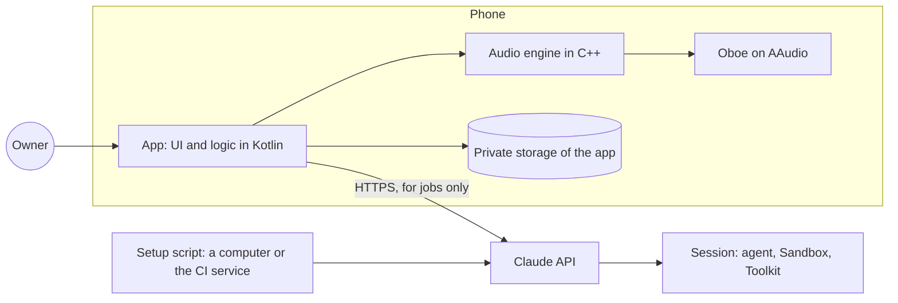
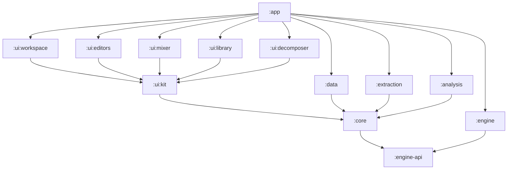
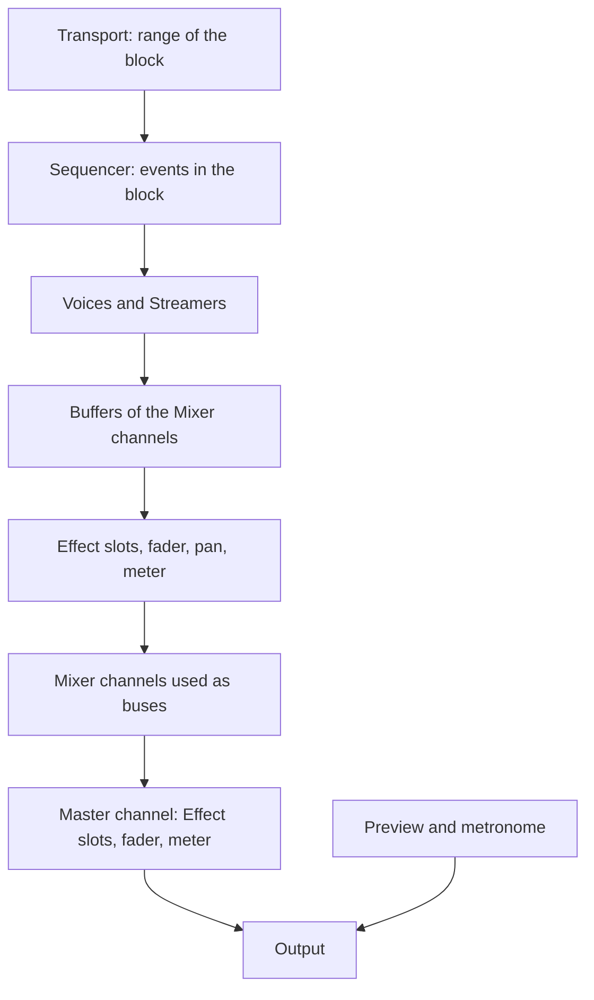
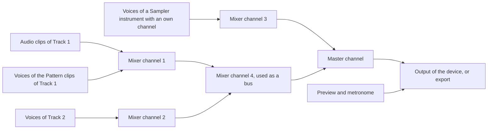
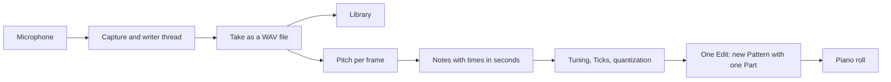
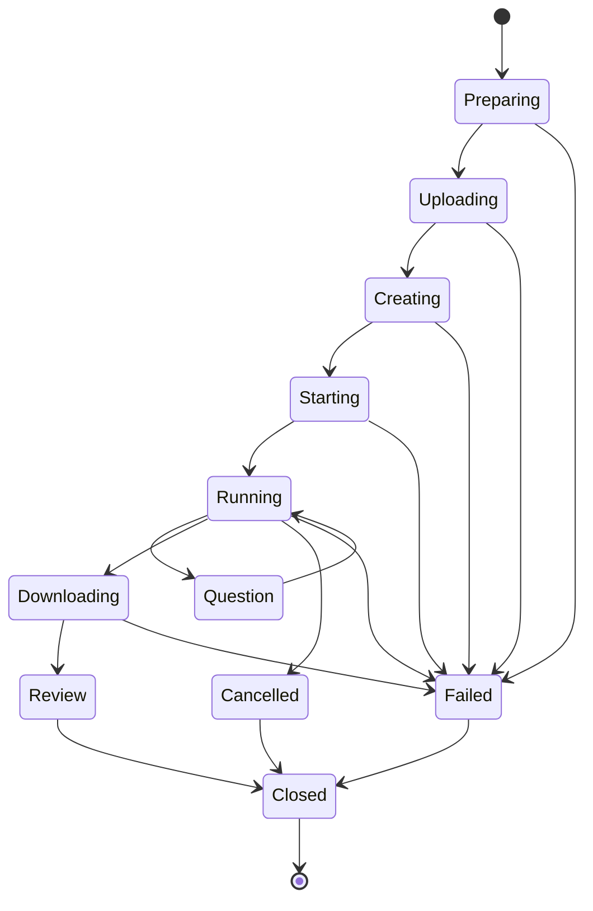
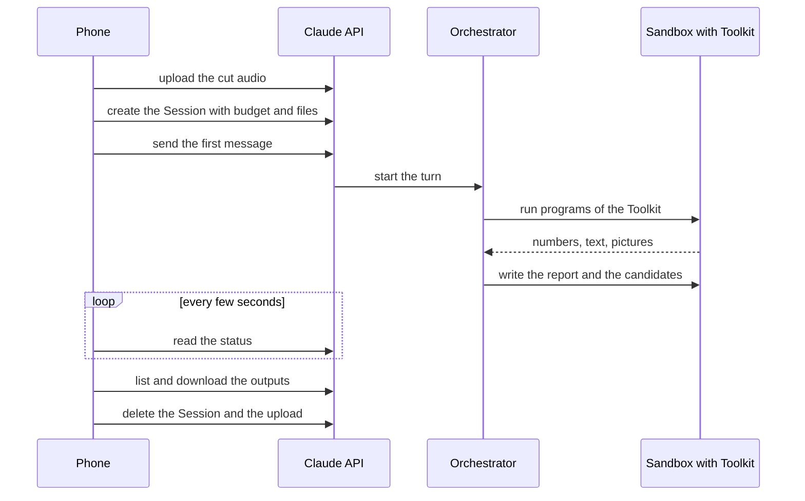
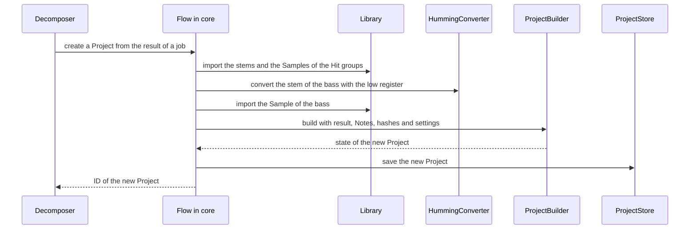
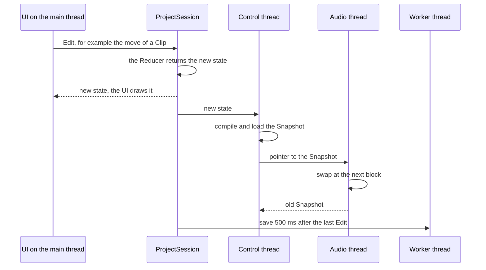
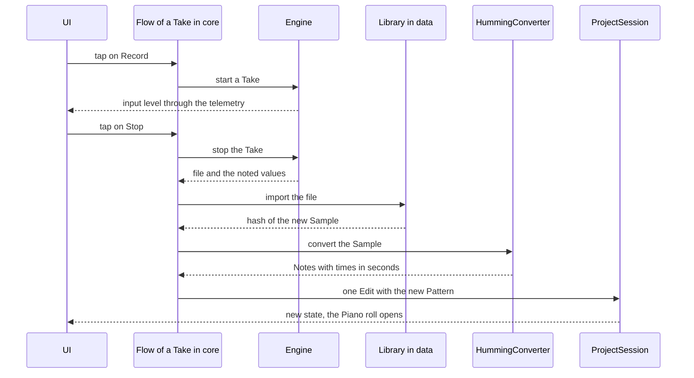

# architecture.md

**Project:** mini daw, a compact DAW for Android phones. All sound comes from samples.
**Stage:** 3 of 6 (architecture) · **Version:** 2.6 · **Date:** 2026-11-21
**Change in 1.1:** the owner has no computer with the Android build tools (D-073). Changed parts: Section 1.1, Section 10.5, Section 15, Section 16.5.
**Change in 1.2:** results of Stage 4. The index of the Library also holds the length of the song of each Project. Changed parts: Section 8.2 (table `project`), Section 16.4 (closing note).
**Change in 2.0:** version 1.1 adds the Decomposer (D-104). New parts: the module `:ui:decomposer`, Section 10.7, Section 16.6. Changed parts: Sections 1.1, 2.1, 2.2, 2.3, 6.1, 6.2, 6.4, 7, 11.4, 12.1, 12.3, 13.2, 14 and 15.
**Change in 2.1:** TK-001. The code has 14 Gradle modules (D-113). A script checks the rules for dependencies. Changed parts: the heading of Section 2 and rule 8 of Section 2.1.
**Change in 2.2:** TK-008. The portable part of the native code of `:analysis` is the CMake target `analysis-core`. Changed part: rule 6 of Section 2.1.
**Change in 2.3:** TK-009. The shared WAV library is the CMake target `wavio` in the folder `native/wavio`. Changed part: rule 7 of Section 2.1.
**Change in 2.4:** TK-004. Section 2.1 names the apps for the checks of PH-00.
**Change in 2.5:** TK-005. Section 12.2 names the first functions of the bridge, for the check V-03.
**Change in 2.6:** TK-006. Section 12.2 adds the function for the check V-07.
**Companion documents:** `requirements.md`, `technology_stack.md` and `project_decisions.md` in their newest versions. `feature_specifications.md` and `ui_ux_specification.md` hold the details of Stage 4. IDs such as `FR-`, `NFR-`, `CON-`, `D-`, `AD-`, `Q-` and `V-` point to them.

---

## How to read this document

Conventions:

1. Names in `code style` are names of modules, files, threads or types in the code.
2. Capitalized names (Project, Part, Mixer channel) are terms of `requirements.md` Section 2. Section 1.3 adds the terms of this document.
3. A heading names the pending decisions (`AD-`) that its section closes, and the decisions (`D-`) that record the result. `project_decisions.md` holds the rows D-057 to D-072.
4. Diagrams use Mermaid. A list in words stands next to each diagram.
5. "(prov.)" marks a provisional number, as in `requirements.md`.
6. `[W1]` to `[W5]` point to the sources in Section 17.

This document fixes the structure: parts, responsibilities, interfaces and flows of data.
Stage 4 fixes the behaviour in detail: formulas, parameters, gestures, texts, and the formats of files field by field.

| Item that the brief asks for in Stage 3 | Section |
|---|---|
| High-level architecture diagram | 1.1, 2.2 |
| Responsibilities of components and modules | 2, 5.1, 6 |
| Data-flow diagrams | 11 |
| Interfaces between components | 12 |
| Audio-processing pipeline | 5.4 |
| Mixer architecture and model for routing | 5.5 |
| Effects-processing pipeline | 5.6 |
| Architecture of the AI orchestration | 10 |
| Storage architecture | 4.4, 8 |
| Strategy for errors | 13 |
| Border between local and cloud operations | 14 |

---

## 1. Overview

### 1.1 The system and its neighbours

Parts:

1. The app on the phone. It holds all data. It does all work except the audio work of an Extraction job and the analysis of a Decomposition job.
2. The Claude API. The app calls it only for Extraction jobs and for Decomposition jobs (D-027, D-106).
3. The place where the setup script runs once: any computer with Python, or the CI service (D-073). The CI service also runs builds and tests during development.

### 1.2 Principles

1. **One source of truth.** The state of a Project lives in Kotlin as one immutable value.
2. **The engine plays a compiled copy.** The engine never reads the Kotlin state. It plays a Snapshot that Kotlin compiles from the state.
3. **The audio thread never waits.** It takes no lock, allocates no memory and touches no file (NFR-RES-03).
4. **Late start.** A part starts when it is first needed, never at launch (D-042).
5. **One module talks to the network.** Every other module works without a network (NFR-SEC-03).
6. **Host first.** Logic and engine build and run their tests on a host computer (NFR-MNT-01).
7. **Files decide.** When a file and an index disagree, the file is right. The app can rebuild every index and every cache from the documents of the Projects and from the audio files.

### 1.3 Terms of this document

| Term | Meaning |
|---|---|
| Edit | One change of a Project as a plain value. Example: "move Clip 12 to Tick 3840 on Track 2". |
| Reducer | The function that applies an Edit to a state and returns the new state. |
| Snapshot | The compiled copy of a Project that the engine plays. It is one block of bytes. |
| Live command | A small message that changes a running value in the engine at once. Example: the level of a fader during a drag. |
| Streamer | The part of the engine that plays one long Audio clip from storage. |
| Control thread | The thread that loads Snapshots and Samples into the engine. |

---

## 2. Modules (AD-04, D-113)

### 2.1 List of modules

| Module | Kind | Content | May depend on |
|---|---|---|---|
| `:engine-api` | Kotlin, no Android | Interfaces `AudioEngine` and `AudioTools`. Types of Live commands and of telemetry. Writer for the format of a Snapshot. A fake engine for tests. | nothing |
| `:core` | Kotlin, no Android | State of a Project, Edits, Reducer, undo, math for time, limits. Compiler from the state to a Snapshot. `ProjectSession`. State of the workspace. Flows that span several parts. From version 1.1 on: `ProjectBuilder`. Writer for standard MIDI files. Interfaces of stores, analysis and extraction. | `:engine-api` |
| `:engine` | Android library with C++ | Native library of the engine: `engine-core` (portable C++), glue for Oboe, JNI bridge. Kotlin classes that implement `:engine-api`. | `:engine-api` |
| `:analysis` | Android library with C++ | Detection of pitch, code for Notes, ONNX Runtime. An own native library. | `:core` |
| `:data` | Android library | Store of Projects. Library with Room. Import. Settings. Store for the secret. | `:core` |
| `:extraction` | Android library | Client of the Claude API. States of a job. Task for WorkManager. Jobs of both kinds: extraction and decomposition. | `:core` |
| `:ui:kit` | Compose | Theme, shared controls (fader, knob, button), helpers for drawing on a canvas. | `:core` |
| `:ui:workspace` | Compose | Shell with two panels, global bar, host of the Mixer, menu of Projects, settings, diagnostics view. From version 1.1 on: the switch between the Studio and the Decomposer. | `:ui:kit` |
| `:ui:editors` | Compose | Playlist, Piano roll, Channel Rack. | `:ui:kit` |
| `:ui:mixer` | Compose | Mixer, Effect editor. | `:ui:kit` |
| `:ui:library` | Compose | Sample browser, Recorder, Module Extraction. | `:ui:kit` |
| `:ui:decomposer` | Compose | The Decomposer: form of a request, list of jobs, review of a result (version 1.1). | `:ui:kit` |
| `:app` | Android app | The activity, the order of startup, the wiring of all parts. | all modules |
| `:benchmark` | Test module | Macrobenchmark tests. Generator of the profiles. | `:app` |
| `toolkit/`, `setup/` | Python, outside Gradle | Toolkit for the Sandbox. Setup script for the account. | — |

Rules for dependencies:

1. The layers depend in one direction: UI, then `:core`, then `:engine-api` (NFR-MNT-04).
2. A UI module uses only `:ui:kit`, `:core` and `:engine-api`. It reaches stores, analysis and extraction through interfaces that `:core` declares.
3. No UI module depends on another UI module, except on `:ui:kit`.
4. Only `:extraction` may use the library for the network.
5. Only `:app` names the concrete classes. One object written by hand, `AppGraph`, creates each part at its first use (D-042).
6. `engine-core` includes no Android header. It is a CMake target that also builds on a host. The same holds for `analysis-core`, the portable part of the native code of `:analysis`.
7. `engine-core` and the native code of `:analysis` share one small static library. It reads and writes WAV files. It is the CMake target `wavio` in the folder `native/wavio`, and it includes no Android header.
8. The script `checks/check_modules.py` checks the list of modules and rules 1 to 4 and 6 on every change. It is a part of the one command (D-113).

`:extraction`, `toolkit/` and `setup/` belong to version 1.0. `:ui:decomposer` belongs to version 1.1 (D-104). All other modules belong to the MVP (D-022).

The app uses no library for navigation. The shell shows the workspace or, from version 1.1 on, the Decomposer (Section 6).

Apps for the checks of PH-00 (TK-004): the check V-02 needs two empty apps of its own, `:checkapps:views` and `:checkapps:compose`. They are no part of the product, use no module of the product, and share one source file in `checkapps/shared`. The second app also holds the prototype of the workspace. The script of the rules for dependencies knows both.

### 2.2 Diagram of the modules

In words: `:app` depends on every module. Each UI module depends on `:ui:kit`. `:ui:kit`, `:data`, `:extraction` and `:analysis` depend on `:core`. `:core` and `:engine` depend on `:engine-api`.

### 2.3 Where the requirements live

| Requirements | Modules |
|---|---|
| Workspace (5.1) | `:ui:workspace`, state of the workspace in `:core` |
| Transport and time (5.2) | `:core`, `:engine` |
| Playlist, Patterns, Piano roll, Channel Rack (5.3, 5.4, 5.15) | `:ui:editors`, `:core` |
| Sampler instruments (5.5) | `:engine`, `:core` |
| Library and Sample browser (5.6) | `:data`, `:ui:library` |
| Recording (5.7) | `:engine`, `:data`, `:ui:library` |
| Humming to MIDI (5.8) | `:analysis`, `:core` |
| Extraction (5.9) | `:extraction`, `:ui:library`, `toolkit/`, `setup/` |
| Mixer and effects (5.10, 5.11) | `:engine`, `:ui:mixer`, `:core` |
| Projects (5.12) | `:core`, `:data` |
| Export (5.13) | `:engine`, `:data` |
| Settings and diagnostics (5.14) | `:ui:workspace`, `:data` |
| Decomposer (5.16) | `:ui:decomposer`, `:extraction`, `:core`, `:analysis`, `toolkit/`, `setup/` |

The section numbers in the first column belong to `requirements.md`.

---

## 3. Threads, channels and budgets (AD-09, D-058)

### 3.1 Threads

| Thread | Work | Rules |
|---|---|---|
| Main thread | UI. It sends Live commands. It reads the telemetry once per frame. | No file work and no network. |
| Control thread | It compiles Snapshots and loads them into the engine. It registers Samples. It opens and closes streams. It frees objects that the engine has retired. | One Kotlin dispatcher with one thread. |
| Audio thread | Callback of the output stream. It renders all audio. | Rules of NFR-RES-03. |
| Input thread | Callback of the input stream. It copies captured audio into a ring buffer. | Rules of NFR-RES-03. |
| Reader thread | It reads long audio ahead from files into ring buffers. | It belongs to the engine. |
| Writer thread | It moves a running Take from a ring buffer into a file. | It belongs to the engine. |
| Worker threads | Import, loading of Samples, analysis, export, saving, network. | Kotlin coroutines. |

### 3.2 Channels between the threads

| From | To | Mechanism | Content |
|---|---|---|---|
| Main thread | Audio thread | Ring buffer with one writer and one reader | Live commands |
| Control thread | Audio thread | A second ring buffer of the same kind | Pointers to new Snapshots and to new objects |
| Audio thread | Control thread | Ring buffer with one writer and one reader | Retired objects; events such as "a Streamer came late" |
| Audio thread | Main thread | One block of shared memory with atomic values | Telemetry (Section 5.10) |
| Audio thread | Reader thread | Atomic positions per Streamer | How far each ring buffer is consumed |
| Input thread | Writer thread | Ring buffer | Captured audio |
| Input thread and writer thread | Control thread | Atomic values | State of a Take: frames written, frames lost, reason of its end |

Rules:

1. Each ring buffer has exactly one thread that writes. Builds for tests assert this.
2. No thread shares a lock with the audio thread or with the input thread.
3. The audio thread never frees memory. Memory that it stops using goes back to the Control thread.
4. The Control thread empties the ring buffer from the audio thread 20 times per second (prov.) while a stream runs. The audio thread sends no signal.
5. The audio thread never calls into the Java runtime.

Reason for two ring buffers toward the audio thread: a tap on a key must not wait for a change of threads (NFR-AUD-03). The main thread therefore writes its Live commands directly.

### 3.3 Budgets

Budget for memory (NFR-RES-01):

| Part | Budget (prov.) |
|---|---|
| Decoded Samples in memory (NFR-RES-02) | 128 MB |
| Ring buffers of the Streamers and of a Take | 8 MB |
| Engine: Snapshots, effects, Voices | 16 MB |
| UI: toolkit, drawing, peaks of waveforms | 80 MB |
| `:analysis` while a conversion runs | 40 MB |
| Runtime, stores, lists for undo | 28 MB |
| Sum | 300 MB |

The check V-01 measures the limit that Android applies on the phone (CON-02). The budget follows this value.

Budget for the processor:

1. The audio thread needs one of the two fast cores (CON-01). Its mean load stays at or below 50 % of the time of one block (NFR-AUD-08).
2. The output stream runs in the low-latency mode with performance hints (D-035). The system then raises the priority of the callback.
3. While the Transport plays, import, analysis and export run at a lower priority than the UI.
4. An offline render uses one worker thread.

---

## 4. Model of a Project (AD-06, AD-10, AD-19)

### 4.1 Entities (D-059)

| Entity | Fields | Notes |
|---|---|---|
| Project | version of the schema, ID, name, dates, tempo, time signature, counter for IDs, Tracks, Patterns, Sampler instruments, Mixer, table of used Samples | Root of the state |
| Track | ID, name, color, mute, solo, ID of its Mixer channel, Clips | Clips are sorted by start. Solo is used from version 1.0 on. |
| Audio clip | ID, hash of the Sample, start in Ticks, offset into the Sample in frames, length in frames, gain | Plays at original speed (D-008) |
| Pattern clip | ID, ID of the Pattern, start in Ticks, length in Ticks, offset into the Pattern in Ticks, gain | Repeats the Pattern when it is longer (D-007) |
| Pattern | ID, name, color, length in Ticks, Parts, hash of the Take that it came from (optional) | The UI offers lengths in whole bars (FR-PT-01) |
| Part | ID of the Sampler instrument, Notes | One Part per Sampler instrument in a Pattern (D-054) |
| Note | pitch, start in Ticks, length in Ticks, velocity | Sorted by start inside a Part |
| Sampler instrument | ID, name, color, hash of the Sample, Root note, play mode, volume, mute. For version 1.0: pan, solo, fine tuning, envelope, loop region, ID of an own Mixer channel. | Belongs to the Project |
| Mixer | Mixer channels, Master channel | — |
| Mixer channel | ID, name, color, volume, pan, mute, solo, Effect slots, output target | Target: the Master channel, or another Mixer channel |
| Effect slot | ID, kind of effect, bypass, parameters | At most 4 per channel |
| Used Sample | hash, name, number of frames, number of channels | Lets a Project open without the index of the Library |

IDs are whole numbers. They are unique inside one Project. The Project stores the counter for the next ID.

The fields for version 1.0 are part of the schema from the first build on. The MVP writes default values into them. A later version then needs no migration for them.

### 4.2 Edits and undo (D-059)

Path of an Edit:

1. The UI creates an Edit.
2. The Reducer checks the Edit and returns a new state. The Reducer is a pure function in `:core`. It runs on the main thread.
3. The old state goes onto the list for undo. The new state becomes the current state.
4. The Control thread compiles a Snapshot from the new state and loads it into the engine (Section 5.2). If several states arrive while it works, it compiles only the newest one.
5. A task saves the document 500 ms after the last Edit (Section 4.4).
6. The UI draws the new state.

Invariants of every state:

1. Every reference points to an existing item (list below).
2. The routing of the Mixer has no loop (FR-MX-11).
3. The limits of `requirements.md` Section 8 hold.
4. A Pattern holds at most one Part per Sampler instrument.
5. Every value lies in its range: pitch, velocity, lengths, tempo.

References that must point to an existing item:

1. The Mixer channel of a Track.
2. The Pattern of a Pattern clip.
3. The Sampler instrument of a Part.
4. The target of a Mixer channel.
5. The Sample of an Audio clip or of a Sampler instrument. It must have an entry in the table of used Samples.

Rule for Clips: an Edit that adds, moves or resizes a Clip must not make two Clips of one Track overlap (D-006).
A change of the tempo can make Audio clips overlap, because their length in Ticks follows the tempo.
The state stays valid in this case. The Sequencer then applies its rule 1 (Section 5.4).

The Reducer refuses an Edit that breaks an invariant or the rule for Clips. It returns the reason. The state stays unchanged.

Edits are applied on the main thread only. A flow on a worker thread hands its Edit to the main thread.

Undo and redo:

1. The list for undo and the list for redo hold whole states. They hold at least 50 states (FR-PRJ-04).
2. Undo moves the current state to the list for redo. The newest state of the list for undo becomes the current state. Steps 4 to 6 of the path then run again.
3. A new Edit empties the list for redo.
4. All states share their unchanged parts. An Edit copies only the lists on the way to the changed item.
5. The lists live in memory only. They belong to the open Project. They are empty after a launch and after a change of the Project.

Gestures:

1. One gesture is one step of undo.
2. Most gestures apply one Edit when the finger lifts. During the drag, the editor draws the moving Clip or Note by itself.
3. A gesture on a control of the Mixer also sends Live commands during the drag. The user hears the change at once. The Edit follows when the finger lifts.
4. Some gestures must sound while they run. Example: a drag across step buttons. Such a gesture applies several Edits, and `ProjectSession` merges them into one step of undo.

State outside the Project: layout of the workspace, zoom, scroll positions, selection, open Pattern, position of the playhead. Undo does not cover it. Section 6.2 describes it.

### 4.3 Time base (AD-10, D-060)

| Item | Value |
|---|---|
| Ticks per quarter note | 960 |
| Rate of the engine | 48,000 frames per second (D-035) |
| Frames per Tick | 3,000 divided by the tempo in BPM |
| Step of the Channel Rack | 240 Ticks (one 1/16 note) |
| Bar in 4/4 | 3,840 Ticks |

Rules:

1. Musical positions are whole Ticks. The engine converts them to frames when it plays.
2. The engine keeps an anchor: one position in Ticks and the frame at which this position was valid. A change of tempo sets a new anchor. Playback therefore continues from the same musical position.
3. An event starts on the frame that is nearest to its exact time. Stage 4 fixes the rule for a tie.
4. The length of an Audio clip is stored in frames. Its length on the timeline follows the tempo (D-008).

Reasons for 960:

1. 960 divides evenly by all grid values of FR-TR-07, including the triplets.
2. At 120 BPM one Tick lasts about half a millisecond. Hummed Notes keep their timing without quantization (FR-H2M-07).
3. A Project of 10 minutes at 300 BPM has fewer than 3 million Ticks. A 32-bit number holds every position.

### 4.4 Document on disk (AD-19, D-061)

The document of a Project is the state of Section 4.1 as JSON (D-043). Its first field is the version of the schema. Stage 4 lists the fields by name.

Steps of a save:

1. A worker thread writes the state into a temporary file in the folder of the Project. The state is immutable, so the main thread goes on at once.
2. The worker forces the file to storage.
3. The worker renames the old document to the name of the backup.
4. The worker renames the temporary file to the name of the document.

Moments of a save:

1. 500 ms after the last Edit.
2. At once when the app leaves the foreground.

Steps of a load:

1. If the document is missing and a temporary file exists, the temporary file becomes the document. This case follows a crash between steps 3 and 4 of a save.
2. The app reads the document. If the reading fails, the app reads the backup.
3. Migration functions convert an older version of the schema to the current one, one version at a time (FR-PRJ-06).
4. The app checks the invariants of Section 4.2 once on the loaded state. A state that fails counts as a document that cannot be read.
5. If both files fail, the app keeps them, opens a new Project and tells the user (Section 13).

A document of a newer version of the schema than the app knows is not opened. The app says so and keeps the file.

---

## 5. Audio engine

### 5.1 Parts of the engine

| Part | Responsibility |
|---|---|
| Transport | Position, playing or stopped, mode, loop region, anchor of the tempo |
| Sequencer | Finds the Clips and Notes that start or end inside the next block |
| Voices | A fixed set of Voices. Each plays one Sample at any speed (D-038). |
| Streamers | Play long audio from storage with read-ahead |
| Mixer | Buffers per channel, Effect slots, faders, pan, order of processing |
| Effects | One effect per used Effect slot. Each keeps its own state. |
| Capture | Moves audio from the input stream into a ring buffer. Aligns a Take in time. |
| Telemetry | Values for the UI |
| Stream manager | Opens, closes and restarts the Oboe streams |

All parts live in `engine-core`, except the Stream manager. The Stream manager lives in the glue for Oboe.

### 5.2 Snapshot (D-062)

A Snapshot holds everything that the engine needs to play a Project. The compiler in `:core` writes it. The engine only reads it.

Content of a Snapshot:

1. Header: version of the format, tempo, time signature.
2. Table of Samples: the hash of each Sample that the Snapshot uses.
3. Sampler instruments with their values.
4. Patterns with their Parts and sorted Notes.
5. Tracks with their sorted Clips.
6. Mixer channels: Effect slots, target, values, and the order of processing.
7. One flag "audible" for every Track, every Sampler instrument and every Mixer channel. The compiler computes the flags from all mute and solo switches.

Steps from a new state to the sound:

1. The Control thread compiles the state into bytes.
2. One JNI call passes the bytes to the engine.
3. The engine checks the bytes: version, sizes, references, order of the channels. It refuses a Snapshot that fails. It then keeps the old one and reports an error.
4. The engine builds the Snapshot in its memory. It links each hash to a loaded Sample and each Effect slot to its effect. It creates each effect and each Streamer that is new.
5. The pointer to the new Snapshot goes into the ring buffer.
6. The audio thread switches to the new Snapshot at the start of its next block.
7. The audio thread sends the old Snapshot back.
8. The Control thread frees the old Snapshot and every object that no Snapshot uses any more.

Rule for values at a swap:

A Snapshot carries every value: levels, pan positions, parameters of effects, tempo.
At a swap, the engine takes a value from the new Snapshot only when it differs from the same value in the Snapshot before.
A value that a Live command has changed in the meantime therefore stays.
Example: one finger holds a fader. A second finger ends another gesture, and its Edit causes a new Snapshot. The held fader keeps its live level.

Rule for sound at a swap:

Voices and Streamers that sound keep sounding.
The engine matches each of them with the new Snapshot by Clip, Sampler instrument, pitch and start.
A Voice without a match ends with a short fade.
When the destination of a sounding source changes, the engine crosses the source over within a few milliseconds (NFR-AUD-06).

Reasons for whole Snapshots instead of small changes:

1. A Snapshot is small. A Project at the limits of version 1.0 compiles into about 100 KB. Compiling and loading take about one millisecond (estimate). The swap itself is one exchange of a pointer.
2. One compiler decides what plays. The engine holds no second copy of the editing logic.
3. A Snapshot is also a file. The tests on a host load the same bytes (Section 15).

Fall-back: the check V-04 measures the time of a compile and of a load. If it exceeds 5 ms (prov.), the compiler keeps the compiled block of every unchanged Pattern and uses it again.

### 5.3 Live commands and calls (D-062)

Live commands go from the main thread to the audio thread. They change running values without a new Snapshot.

| Live command | Content | Effect |
|---|---|---|
| Play, Stop | — | Starts or stops the Transport with short fades |
| Seek | position in Ticks | Moves the playhead. Sounding Voices fade out. |
| Set mode | Song mode or Pattern mode; the Pattern; the Track | Selects what the Transport plays (FR-TR-02, FR-MX-15) |
| Set loop | start, end, on or off | Loop region of Song mode (FR-TR-11) |
| Set tempo | BPM | Sets a new anchor while the user drags the tempo |
| Set value | ID of the target, parameter, value | Fader, pan, parameter of an effect, volume of a Sampler instrument. The engine ramps to the value (FR-MX-13). |
| Note on, Note off | Sampler instrument, pitch, velocity, Track | Keys of the Piano roll, step buttons, a new Note (FR-PT-05) |
| Stop preview | — | Ends the preview of a Sample |
| Metronome | on or off | FR-TR-09 |

A Live command names its target by ID. The engine drops a command for an ID that the current Snapshot does not hold. The diagnostics count such drops.

The final value of a gesture also reaches the Project through an Edit (Section 4.2). The next Snapshot then carries the same value. Nothing jumps.

Calls on the Control thread may take time. They never run on the main thread.

| Call | Content | Effect |
|---|---|---|
| Load a Snapshot | bytes | Section 5.2 |
| Register a Sample | hash, path, kind of use | Loads the audio into memory, or prepares a Streamer (Section 5.7) |
| Release a Sample | hash | Frees the memory once no Snapshot uses the Sample |
| Start a preview | hash | Loads the Sample if needed. Then plays it after the Master channel (FR-LIB-03). |
| Start a Take, stop a Take | path of the file | Section 5.8 |
| Open or close the streams | — | Section 5.11 |
| Read events | — | Empties the ring buffer from the audio thread |

### 5.4 Render of one block (D-063)

Steps of the render function:

1. Read all waiting Live commands and a waiting Snapshot.
2. Cut the request of the stream into internal blocks of at most 128 frames (prov.).
3. For each internal block, ask the Transport for the range in Ticks.
4. Let the Sequencer start and end Voices and Streamers. Each start carries its exact frame inside the block.
5. Clear the buffers of all channels.
6. Render every Voice and every Streamer into the buffer of its Mixer channel.
7. Process the Mixer channels in the order of the Snapshot (Section 5.5).
8. Process the Master channel.
9. Add the preview and the metronome after the Master channel (FR-MX-14).
10. Clamp the result to full scale. Set the flag for clipping of the output when a value was clamped (FR-MX-08, NFR-AUD-12).
11. Write the telemetry.

The same function serves real time, export and tests (D-036). Nothing inside it depends on the clock or on another thread. This gives the deterministic render of NFR-AUD-11.

Rules of the Sequencer:

1. A Clip ends where the next Clip of its Track starts. The earlier Clip ends with a short fade (D-006).
2. When the playhead starts inside an Audio clip, the Clip plays from the matching place in its Sample.
3. When the playhead starts inside a Pattern clip, Notes that began earlier do not sound.
4. At the limit of Voices, the oldest Voice ends with a quick fade (FR-SM-07).

Where each control acts:

| Control | Acts on | Place in the path |
|---|---|---|
| Velocity of a Note | one Voice | Gain of the Voice |
| Volume and pan of a Sampler instrument | all its Voices | Gain and pan of each Voice |
| Gain of a Clip | the Voices or the Streamer of this Clip | Gain of each source |
| Mute and solo of a Sampler instrument; mute and solo of a Track | the sources that belong to it | Flag "audible", as a ramped gain of each source |
| Effect slots, fader, pan, mute and solo of a Mixer channel | the sum of the channel | Stations of the channel (Section 5.5) |
| Controls of the Master channel | the sum of all channels | Last stations before the output |

### 5.5 Mixer and routing (AD-13, D-063)

Rules of routing:

1. Every Track sends to exactly one Mixer channel. Several Tracks can share one channel (FR-MX-02, D-004).
2. A source goes to the own Mixer channel of its Sampler instrument, if the instrument has one. Otherwise it goes to the Mixer channel of the Track that holds the Clip (FR-MX-19, D-055).
3. In Pattern mode, and for keys and step buttons, the source uses the Track from which the user opened the Pattern. Without such a Track it goes to the Master channel (FR-MX-15).
4. A Mixer channel sends to the Master channel, or to one other Mixer channel that serves as a bus (FR-MX-11).
5. The graph has no loop. The Reducer refuses an Edit that would create one.
6. The preview and the metronome join after the Master channel.

Stations inside one channel, in order:

1. Sum of the inputs.
2. Effect slots 1 to 4 (FR-MX-09).
3. Fader.
4. Pan.
5. Meter (FR-MX-07).
6. Output to the target.

Order of processing: the compiler sorts the channels so that every channel comes before its target. The engine processes this list once per block. A change of routing causes a new Snapshot with a new order.

Mute and solo: the compiler turns all switches into the flags "audible". The engine only ramps one gain between 0 and 1 for each flag. Stage 4 defines the rules that the compiler applies (FR-MX-06).

Time: Voices, effects and meters run inside one render function on the same block. No part of the Mixer has a clock of its own. The Mixer therefore cannot drift from the Playlist (FR-PL-09, FR-MX-14).

Left for Stage 4: curve of the fader, pan law, rules of solo with buses, fall of the meters (AD-13, AD-15).

### 5.6 Pipeline of an effect (D-064)

Every effect offers the same small set of operations:

| Operation | Called by | Purpose |
|---|---|---|
| Prepare | Control thread | Allocates all memory for the rate of the engine |
| Set value | Audio thread, after a Live command or a swap | Stores a target value. The effect ramps to it (FR-FX-06). |
| Process | Audio thread | Changes one block in place |
| Reset | Audio thread | Clears the internal state |
| Is silent | Audio thread | Reports that the input and the tail have ended |

Life of an effect:

1. The Control thread creates and prepares the effect when a Snapshot first names its Effect slot.
2. The effect stays alive through every later swap. Its tail and its filters continue without a jump.
3. Bypass ramps between the processed and the unprocessed signal.
4. The Control thread frees the effect after the last Snapshot that named it has been retired.

Rules:

1. While it processes, no effect allocates memory or waits. No effect delays its signal to look ahead (D-013).
2. After Stop, the effects keep running until they are silent (FR-FX-08).
3. The engine skips a channel whose inputs and effects are all silent. Its output is then exactly zero (NFR-SMP-02).
4. The Project stores each parameter in its real unit, for example Hz, dB or ms. The UI maps the value to the position of a control.

Stage 4 fixes the catalog, the parameters and their ranges (AD-14).

### 5.7 Samples in the engine (AD-11, D-065)

| Kind of audio | Where it lives | How it arrives |
|---|---|---|
| Sample of a Sampler instrument | Memory, with two pre-filtered copies (D-038) | A worker thread reads the file. The Control thread registers the result. |
| Short Audio clip, up to 20 s | Memory | Same path, without copies |
| Long Audio clip | Streamer | The reader thread keeps the ring buffer filled |
| Preview | Memory or Streamer, by length | Same rules |

Sizes (prov.):

| Item | Value |
|---|---|
| Ring buffer of one Streamer | 1 s of audio |
| Refill of a ring buffer | When it is less than half full |
| Look-ahead of the reader thread | Every long Audio clip that starts within the next 2 s gets a filled Streamer |
| Ring buffer of a Take | 2 s of audio |
| Ring buffers for Live commands and Snapshots | 1,024 entries each |

Rules:

1. A Sample that is not loaded yet plays as silence. The diagnostics count this case.
2. While the Transport is stopped, the reader thread keeps the Streamers filled for the position of the playhead. Play then starts at once.
3. After a Seek during playback, a Streamer can be empty for a moment. Its Clip then fades in as soon as audio arrives.
4. The pre-filtered copies are built at the first load of a Sample. They are stored in the folder for caches.
5. Loaded Samples are immutable. The live engine and an offline render share them.
6. A loader in `:core` watches the state of the Project. It registers every Sample that the Project uses, and it releases the others.
7. When a Sample has finished loading, the Control thread loads the current Snapshot again. The engine then links the new Sample.

Rules at the cap for memory (NFR-RES-02):

1. The Control thread first unloads Samples that no Snapshot uses, oldest first.
2. Short Audio clips then play through Streamers.
3. A Sampler instrument whose Sample still does not fit stays silent. The app shows a message.

### 5.8 Path of a Take (D-040, D-065)

1. The Stream manager opens the input stream when a Take starts.
2. The input callback copies each block into the ring buffer of the Take.
3. The writer thread moves the data into a WAV file. It flushes the file every second.
4. The engine notes three values for the first captured frame, and again for the last one (list below).
5. When the Take ends, `:core` computes the start of the Take on the timeline. It uses the values of the first frame and the offset from the settings.
6. The import turns the file into a Sample of the Library (Section 8.4).

Values that the engine notes for the first and for the last captured frame:

1. The position of the Transport.
2. The timestamp of the input stream.
3. The timestamp of the output stream.

The two sets of values show whether input and output ran at the same speed. They can differ when the two streams use different devices, for example the built-in microphone and USB-C headphones.

After a crash, the next launch finds the unfinished file. The app repairs the header from the size of the file and adds the Take to the Library (NFR-REL-02).

The check V-03 also measures the time to open and start the input stream. If this time breaks NFR-PERF-04, the app opens the input stream as soon as the Recorder is shown.

### 5.9 Offline render and export (AD-17, D-066)

Steps of an export:

1. The app creates a second engine without streams.
2. The second engine gets the current Snapshot. It shares the loaded Samples.
3. A worker thread calls the render function in a loop with blocks of 128 frames.
4. Long audio is read directly from the files, without the reader thread.
5. The loop ends when the song has ended and every channel is silent.
6. The worker writes the result into a file in the folder for caches. The user then saves or shares it (FR-EXP-04).

Rules:

1. The metronome and the preview are never part of an offline render (FR-TR-09).
2. The live engine stays untouched. The user can go on working.
3. WAV files come from own code. AAC files come from the encoder of Android (FR-EXP-01, FR-EXP-02).
4. Tests use the same path on a host.

### 5.10 Telemetry (D-058)

The engine publishes these values in one block of shared memory. The UI reads them once per frame, without a call into the engine.

1. Position of the Transport, playing or stopped, and mode.
2. The time at which the output plays this position. The UI computes from it the position that the user hears now (FR-TR-10).
3. Peak of the left and the right side, for every channel and for the input.
4. Flags for clipping.
5. Number of sounding Voices.
6. Load of the audio thread.
7. Counts: Underruns, late Streamers, dropped Live commands, Samples that were not loaded.

A counter protects the values that belong together. The reader repeats its read when the counter changed in between.

### 5.11 Streams, audio focus and background (AD-18, D-067)

| Event | Reaction |
|---|---|
| First touch on the workspace after a pause | The Stream manager opens the output stream. A tap on a key then sounds without delay. |
| Start of a Take | The Stream manager opens the input stream |
| No sound, no Take and no touch for 30 s (prov.) | Both streams close (NFR-RES-04) |
| Play | The app asks for audio focus (NFR-AUD-14) |
| Loss of audio focus, or a call | Playback pauses |
| Headphones removed | Playback pauses (NFR-AUD-10) |
| The audio device changes (D-053) | The Stream manager closes the stream and opens it on the new device |
| A stream reports an error | Same reaction as for a new device. After two failures in a row the app shows the cause and offers a retry (NFR-REL-03). |
| The app leaves the foreground | Playback stops. A running Take ends and is saved. The streams close. The document is saved (D-020). |
| An Underrun | The buffer grows by one Burst (NFR-AUD-09) |
| Playback or a Take runs | The screen stays on |

The engine lives as long as the process. Streams open and close many times.

Version 1 uses no foreground service (D-049). All sound ends when the app leaves the foreground. This also meets the limits of Android 17 for audio in the background (CON-08).

---

## 6. UI (AD-01, AD-04, D-068)

### 6.1 Structure of the screen

The app has one activity. Up to version 1.0 it has one screen: the workspace. Version 1.1 adds a second screen, the Decomposer (Section 10.7). The shell shows one of the two. Everything else opens over the shown screen.

| Layer | Content | Opened by |
|---|---|---|
| Workspace | Global bar, Playlist, Editing workspace with one Module | Always present |
| Decomposer (version 1.1) | Takes the place of the workspace while it is shown | The Mode switch (FR-DEC-01) |
| Mixer | Lies over the workspace, in one of two sizes (D-012) | The Mixer control of the global bar (FR-WS-08) |
| Sheets | Menu of Projects, settings, diagnostics view, page of licences | The Project menu |
| Dialogs | A question that needs an answer. Example: "Delete this Pattern?" | An action of the user |

Rules:

1. The Back gesture closes the top layer. On the bare workspace it leaves the app. On the bare Decomposer it returns to the workspace.
2. `:ui:workspace` offers the shell with empty places. `:app` fills the places with the Modules of the other UI modules.
3. The window uses the full screen and keeps clear of the display cutout (FR-WS-11).

### 6.2 Layers of state

| Layer | Content | Lives in | Saved in |
|---|---|---|---|
| State of the Project | Section 4.1 | `ProjectSession` in `:core` | Document of the Project |
| Layout of the workspace | Sides of the panels, border, active Module, Mixer open or closed | `WorkspaceState` in `:core` | DataStore, 500 ms after a change (FR-WS-10) |
| Shown screen (version 1.1) | Studio or Decomposer | `WorkspaceState` in `:core` | Nowhere. Every launch starts in the Studio. |
| State of the Decomposer (version 1.1) | Source, range, options, shown page, shown job, settings of a review | `DecomposerState` in `:core` | Nowhere. The jobs themselves live in the store of jobs. |
| View of each editor | Zoom, scroll position, tool | `WorkspaceState` in `:core` | DataStore: the zoom (FR-WS-10) |
| Focus | Open Pattern and Part, selected Track, selected Effect slot, selected Clips and Notes | `WorkspaceState` in `:core` | DataStore: the open Pattern and Part |
| State of a gesture | The drag in progress | The editor | Nowhere |
| Telemetry | Section 5.10 | Shared memory | Nowhere |

Rules:

1. All holders of state belong to `AppGraph`, outside the activity. A new activity binds to them again. A change of configuration therefore loses nothing.
2. Data flows one way. An event of the UI becomes an Edit, a Live command or a change of the state of the workspace. The UI then draws the new state.
3. The UI modules follow each other through `WorkspaceState`. Example: a double tap on a Pattern clip sets the open Pattern and the active Module (FR-WS-09).
4. A hidden Module keeps its state, because the state does not live inside the Module (FR-WS-06). The swap of the panels keeps all state for the same reason (FR-WS-03).

### 6.3 Structure of an editor

The rules of `technology_stack.md` Section 6.1 hold. Each editor has four pieces:

| Piece | Task | Tested |
|---|---|---|
| Geometry | Maps Ticks, pitches and rows to pixels and back. Plain Kotlin. | On the host |
| Hit test | Finds the Clip, the Note or the handle under a finger. Plain Kotlin. | On the host |
| Gestures | Turn touches into moves of the view, Edits and Live commands | On the host, with recorded touches |
| Drawing | Draws the visible range on one canvas | On the phone |

Rules:

1. A loop per frame runs only while the Transport plays, a meter moves or a gesture runs. It reads the telemetry. It redraws the playhead and the meters in the draw phase.
2. An Audio clip draws its waveform from a file of peaks (Section 8.5). A worker thread loads the file. Until then the Clip shows a plain block.
3. The editors of the MVP are the Playlist, the Piano roll and the Channel Rack. The strips of the Mixer follow the same structure.

### 6.4 Entries from outside

| Entry | Action |
|---|---|
| Launcher icon | Opens the workspace with the last Project (FR-PRJ-01) |
| Shortcut on the launcher icon | Creates a new Project and starts a Take (FR-REC-10) |
| Share from another app | Imports the file into the Library (FR-LIB-08), or uses it as the source of an Extraction job (FR-AIX-01) or of a Decomposition job (FR-DEC-03) |
| Tap on a notification | Opens the Module Extraction with the job (FR-AIX-10). For a Decomposition job, it opens the Decomposer with the job (FR-DEC-11). |

All entries arrive at the one activity. The activity turns each entry into an action. The action runs when the workspace is ready.

The app asks for the microphone permission at the first Take (FR-REC-01). It asks for the notification permission at the first job of either kind. Both questions come from the system.

---

## 7. Startup (AD-05, D-068)

| Step | Moment | Thread | Work |
|---|---|---|---|
| 1 | Start of the process | Main | `Application` creates the empty `AppGraph`. No library starts itself. |
| 2 | Same moment | Worker | Reads the saved layout. Reads and parses the document of the last Project. |
| 3 | Creation of the activity | Main | Sets full screen and landscape. Sets the workspace as content. |
| 4 | First frame | Main | Draws the shell: bar, panels, border. It uses the saved layout if step 2 has delivered it. Otherwise it uses the default layout. |
| 5 | Project parsed | Main | Publishes the state. The editors draw Clips and Notes. The app reports "fully drawn". |
| 6 | After the first frame | Control | Loads the native library. Creates the engine. Registers the click of the metronome and the Samples of the Project. Loads the first Snapshot. |
| 7 | Engine ready | Main | Enables Play and Record. |
| 8 | A few seconds later | Worker | Looks for unfinished Takes and for unfinished jobs of both kinds. Runs the cleanup of the Library (Section 8.3). |

Parts that start at their first use:

1. The database of the Library: when the Sample browser opens, or at an import.
2. `:analysis` with its native library: at the first conversion.
3. The client for the network and WorkManager: at the first job of either kind, or when step 8 finds a job.
4. The input stream: at the first Take.
5. The output stream: at the first touch (Section 5.11).

Rules:

1. The main thread reads no file and waits for no worker (NFR-PERF-06).
2. The app adds no splash screen and never prolongs the one of the system (CON-05).
3. Step 6 registers the Samples of the Sampler instruments first, then the Samples of the Clips in the order of their start.
4. At the first launch, step 2 finds no Project. The app opens a new empty Project in memory. A worker copies the factory set from the app package into the Library (FR-LIB-07).
5. After a return from the background, all holders of state are still alive. The workspace draws at once (NFR-PERF-03).
6. Every launch starts in the Studio. The Decomposer is created at its first use (FR-DEC-01). It adds no work to the steps 1 to 7.

The Baseline Profile and the Startup Profile cover steps 1 to 7 (D-042).

---

## 8. Storage (AD-20, D-069)

### 8.1 Folders

All paths lie in the private storage of the app.

| Path | Content | Can be rebuilt |
|---|---|---|
| `files/projects/<id>/project.json` | Document of a Project | No |
| `files/projects/<id>/project.json.bak` | Backup of the document | — |
| `files/library/audio/<hh>/<hash>.wav` | Audio of the Library. `<hh>` is the start of the hash. | No |
| `files/takes/<id>.wav` | A Take in progress | No |
| `files/extraction/<job>/` | State and files of one Extraction job | No |
| `databases/library.db` | Index of the Library | Mostly (Section 8.2) |
| `no_backup/secret/api_key.bin` | Encrypted API key (D-048) | No |
| DataStore files | Settings, saved layout, ID of the last Project, IDs of the setup on the account | No |
| `cache/peaks/` | Peaks of waveforms | Yes |
| `cache/copies/` | Pre-filtered copies of instrument Samples | Yes |
| `cache/analysis/` | Pitch curves of Takes | Yes |
| `cache/export/` | Results of exports until the user has saved them | Yes |

### 8.2 Index of the Library

| Table | Content |
|---|---|
| `sample` | Hash (key), name, group, number of frames, number of channels, original rate, origin, date, detected Root note, favorite, time of deletion |
| `sample_info` | For an Extracted Sample: source, range, description, date, names of the models (FR-AIX-12) |
| `tag`, `sample_tag` | Tags (FR-LIB-02) |
| `project` | ID, name, dates, length of the song |
| `sample_use` | Which Project uses which hash |

Rules:

1. The hash is SHA-256 over the audio in the format of the Library. The same audio is stored once.
2. The database opens at its first use, never at startup. Startup needs only the ID of the last Project, and DataStore holds it.
3. One thread at a time changes the Library. All changes pass through one queue.
4. If the database is lost, the app builds it again from the documents and the audio files. Samples that a Project uses get their names back from the tables of used Samples. Other Samples get a plain name and the group Imported.

### 8.3 Samples in use (FR-LIB-06)

Rules:

1. A Project names a Sample by its hash. Its table of used Samples also stores name, length and number of channels.
2. "Delete" in the Sample browser sets the time of deletion on the row. The Sample leaves the browser. The audio file stays.
3. Each save of a Project updates the rows of this Project in `sample_use`.
4. A cleanup runs once per process, shortly after startup. It removes an audio file only when both conditions below hold.
5. An import of audio that is already present makes the old row visible again.
6. A missing or broken audio file never blocks a Project. The app marks the Clips, and the engine plays silence for them (NFR-REL-04).

Conditions of the cleanup:

1. The row of the file was deleted before this process started.
2. No saved Project uses the hash.

Reason for rule 4: undo. The lists for undo belong to the open Project. They live inside one process. A state on these lists can only use Samples that were visible during this process. The cleanup never removes such a Sample.

### 8.4 Import

Every new Sample takes the same path:

1. A source delivers decoded audio. Android decodes compressed files. WAV files are read directly (D-037).
2. `AudioTools` converts the audio to 48 kHz when needed. It writes a temporary WAV file and computes the hash on the way.
3. The file moves to its place under its hash. If this hash already exists, the temporary file is dropped.
4. The index gets a row, or the old row becomes visible again.
5. The peaks are built when the Sample is first shown. The pre-filtered copies are built when a Sampler instrument first loads it.

Sources that use this path:

1. The file picker of the system.
2. A share from another app.
3. A finished Take.
4. An accepted candidate of an Extraction job.
5. The factory set at the first launch.

### 8.5 Caches

| Cache | Content | Built |
|---|---|---|
| Peaks | Lowest and highest value per 256 frames (prov.), plus coarser levels | At the first display, by a worker thread |
| Pre-filtered copies | Copies at half and at a quarter of the rate (D-038) | At the first load into the engine |
| Pitch curve | Pitch, confidence and loudness per frame of a Take | At the conversion |
| Export | Rendered files | At an export. The app deletes them after 24 h (prov.). |

Android may empty the folder for caches at any time. The app builds a missing file again.

### 8.6 Backup and transfer (NFR-SEC-07)

| Data | Cloud backup of the system | Transfer to a new phone |
|---|---|---|
| Settings and layout | Yes | Yes |
| Projects, audio and index of the Library | No, because of the size | Yes |
| API key, Extraction jobs, Takes in progress, caches | No | No |

The archive of a Project (FR-PRJ-07) is the explicit way to move one Project. Stage 4 fixes the rules for backup in detail.

### 8.7 Free storage (NFR-RES-06)

1. The app checks the free storage before a Take, an import, an export and a download.
2. During a Take the writer thread checks it every few seconds. The Take ends safely before the storage runs out.
3. Below 500 MB (prov.) the app shows a warning.

---

## 9. Humming to MIDI

Steps:

1. The Take ends (Section 5.8). The import turns it into a Sample (FR-H2M-06).
2. `HummingConverter` reads the file piece by piece on a worker thread. It reduces the rate to the rate that the method needs.
3. The detection of pitch gives pitch, confidence and loudness per frame (D-044). The result goes into the cache.
4. The code for Notes cuts this curve into Notes with times in seconds. It also estimates how far the singer is from standard tuning (FR-H2M-09).
5. `:core` turns this result into Notes of the Project (list below).
6. One Edit adds the Pattern, its Part and its Notes. One undo removes them together.
7. `WorkspaceState` opens the Part in the Piano roll (FR-H2M-04).

Work of `:core` in step 5:

1. It corrects the tuning.
2. It rounds each pitch to a semitone.
3. It maps seconds to Ticks with the tempo of the Project.
4. It applies the chosen quantization (FR-H2M-07).

Rules:

1. Every step runs on the phone, without a network (FR-H2M-02, NFR-SEC-03).
2. The native library of `:analysis` loads at the first conversion. If SwiftF0 wins the check V-05, ONNX Runtime loads at the same moment.
3. The conversion shows progress, and the user can cancel it (NFR-PERF-08).
4. A new run with other settings reads the pitch curve from the cache. Only steps 4 to 6 run again (FR-H2M-10).
5. The detection of the Root note of a Sample uses step 3 as well (FR-SM-02).
6. Both candidates of D-044 sit behind one interface, `PitchDetector`. The candidate that loses V-05 leaves the code.

---

## 10. Extraction (AD-26, AD-27, AD-28, D-070)

### 10.1 Parts

| Part | Where | Task |
|---|---|---|
| Module Extraction | `:ui:library` | Form of a request, list of jobs, review of candidates |
| `ExtractionService` | `:extraction` | Entry for the UI: start, answer, cancel, delete, accept |
| Store of jobs | `:extraction` | One folder per job. It holds the state of the job and its files. |
| `SourceReader` | `:extraction` | Fetches the source: a file, a shared file or a direct link (D-015) |
| `AudioFiles` | `:data` | Cuts the range plus the margin into a WAV file (FR-AIX-06) |
| `ClaudeApi` | `:extraction` | The only code that calls the Claude API (D-045) |
| Runner | `:extraction` | Moves a job from state to state |
| Ledger of cost | `:extraction` | Records the cost of each job. Enforces the limits (NFR-COST-03, NFR-COST-04). |
| Agent, environment, Toolkit | Account of the owner | Section 10.5 |

### 10.2 States of a job

| State | Work in this state | Stored when the work is done |
|---|---|---|
| Preparing | Checks the key, the setup and the limits. Fetches the source. Cuts the range. | Path of the cut file |
| Uploading | Uploads the cut file with an expiry time | ID of the file |
| Creating | Creates the Session with agent, environment, files and budget. Sends no message yet. | ID of the Session |
| Starting | Sends the first message, unless the Session already holds one | — |
| Running | Reads the status of the Session | Reason of the stop, cost |
| Question | Shows the question of the Orchestrator. Sends the answer of the user as a new message (FR-AIX-07). | — |
| Downloading | Lists the files of the Session. Downloads the report and the candidates. Then cleans the account. | Paths of the files |
| Review | The user listens, then accepts or rejects (FR-AIX-11) | Hash of the accepted Sample |
| Cancelled | Cleans the account | — |
| Failed | Cleans the account. Shows the cause. Offers a retry (FR-AIX-14). | Cause |
| Closed | No work. The local files of the job stay until the user deletes the job (FR-SET-04). | — |

Cleaning the account means two actions:

1. The Runner deletes the Session. It interrupts a running Session first, because only an idle Session can be deleted [W1].
2. The Runner deletes the uploaded file.

Rules:

1. The Runner stores the new state before it starts the work of this state.
2. The work of every state can run twice without harm.
3. State Creating: before the Runner creates a Session, it looks for a Session of the agent that already holds the uploaded file. It adopts this Session. A repeat therefore never creates a second Session (NFR-REL-05).
4. State Starting: the Runner first lists the events of the Session. It sends the first message only when none is there.
5. A Session without a message does no work. The service bills running time only while a Session runs [W4].
6. The Runner goes to Downloading when the three signs of a normal end are present (list below) [W3].
7. The reason `budget_reached` means that the budget stopped the Session [W4]. If a report exists, the job still goes to Downloading. Otherwise it fails with the cause "budget".
8. The status `terminated` means a failure. The status `rescheduling` counts as running [W1].
9. The Runner interrupts a Session that runs longer than 10 min. The job then fails with the cause "time limit" (NFR-COST-01). In the background the Runner can run late. The budget of the Session is the bound that always holds.
10. If the cleaning of the account fails, the job keeps a mark, and the Runner tries again later. The expiry time of the upload is the second safeguard (NFR-SEC-04).
11. A retry by the user is a new job with the same input. It is linked to the first job, and it uses the cut file again (FR-AIX-14).
12. The user can cancel a job in every state before Review. The diagram shows only one arrow for this.

Signs of a normal end:

1. The status is `idle`.
2. The reason of the stop is `end_turn`.
3. The report exists among the files of the Session.

Who runs the Runner:

| Situation | Mechanism |
|---|---|
| The app is visible | A coroutine. It reads the status every 5 s (prov.). |
| The app is not visible | One task of WorkManager per job, with the condition "network" and growing delays (D-049) |
| After a restart of the app or of the phone | WorkManager starts the task again. Step 8 of the startup also finds the job. |

Both mechanisms call the same function. A lock per job makes sure that only one of them works on a job at a time.

The app shows a notification when a job reaches Review, Question or Failed while the app is not visible (FR-AIX-10).

### 10.3 Calls to the Claude API

| Call | Used in the state |
|---|---|
| Upload a file with an expiry time | Uploading |
| Create a Session | Creating |
| List the Sessions of the agent | Creating, before a retry; cleanup of lost Sessions |
| Send an event: a message or an interrupt | Starting, Question; an interrupt before a deletion |
| List the events of chosen types | Starting; Running, for the reason of the stop |
| Read a Session | Running, for status and cost |
| List the files of a Session; download a file | Downloading |
| Delete a Session; delete a file | Cleaning of the account: Downloading, Cancelled, Failed |
| List agents, environments and files | Discovery of the setup (Section 10.5) |

This table refines `technology_stack.md` Section 9.2. The creation of a Session and its first message are now two calls. Two calls make rule 3 and rule 4 of Section 10.2 possible [W2].

Rules for the client:

1. All calls sit behind the interface `ClaudeApi`. Tests use a fake.
2. The header for the beta version of the service stands in one place.
3. The client reads the API key from `SecretStore` for one call. It never logs the key (NFR-SEC-09).
4. The service is in beta (CON-18). The implementer confirms the exact names of the fields against the documentation when the client is written.

### 10.4 Contract with the Session

Files that the Session receives, mounted for reading only (D-046):

1. The cut audio.
2. The Toolkit.
3. The model file.

The Session also receives the first message. The app builds it from a fixed template.

Values in the first message:

1. The mode: quick or free.
2. The range inside the uploaded file.
3. The description of the sound.
4. The largest number of candidates.

What the Session returns in its folder for outputs:

1. One file with the report, `report.json`.
2. One WAV file per candidate.

| Part of the report | Content |
|---|---|
| Result | Done, question, nothing found, or error |
| Candidates | Name of the file, label, note about the content, length, peak level (FR-AIX-09) |
| Question | The text of one question (FR-AIX-07) |
| Steps | What the Orchestrator did (NFR-QLT-05) |
| Models | Names and versions (FR-AIX-12) |
| Version | Version of the report and of the Toolkit |

Rules inside the Session:

1. The Orchestrator works only through the programs of the Toolkit. Each program is one command. It prints its result as JSON (`technology_stack.md` Section 9.4).
2. In quick mode, one program runs all steps for one of the usual classes. The Orchestrator starts it and checks the result. This needs few tokens (FR-AIX-17).
3. The Toolkit does not depend on Claude. Its programs run the same way on a host, where the tests call them.

Rules on the phone (NFR-SEC-06):

1. The report and the candidates are untrusted input.
2. The app limits the size of the report and of each file.
3. The app downloads only files with the expected names.
4. The app checks the header and the length of each WAV file before the import.
5. The app shows every text of the report as plain text.
6. The app refuses a report with an unknown version.

Stage 4 fixes the fields of the report, the template of the first message and the system prompt.

### 10.5 Setup on the account (AD-27)

The setup script runs once (FR-AIX-20). It needs only Python. It runs on any computer of the owner, or as a manual task of the CI service (D-073). It reads the API key from an environment variable and stores it nowhere.

Steps of the script:

1. It uploads the Toolkit and the model file to the file storage of the account.
2. It creates the environment: packages, limited network (D-047).
3. It creates the agent: model tier, system prompt, tools.
4. It gives the files, the environment and the agent fixed names. Each name contains the version of the Toolkit.

How the app finds the setup:

1. At the first job, the app lists agents, environments and files and looks for the fixed names.
2. It stores the IDs in DataStore. The IDs are not secrets.
3. If a name is missing, the job fails with the cause "setup missing". The Module explains the step.
4. A new version of the Toolkit means a new run of the script. The app picks the newest version that it knows.

The request that creates a Session can replace the model of the agent for this one Session [W2]. The app uses this to pick the model tier per job (D-047).

### 10.6 Cost (NFR-COST-01 to -04)

1. Before the state Preparing, the ledger checks the limit of jobs per day and the limit of cost per month (FR-AIX-15).
2. The call that creates the Session carries the budget. The service takes the amount in whole US cents [W4].
3. After the end, the Runner reads the cost of the Session from its usage and writes it into the ledger [W4].
4. Between jobs no Session exists. Nothing costs money then (NFR-COST-02).

### 10.7 Decomposition (version 1.1; D-104, D-106, D-108, D-109)

A Decomposition job reuses the parts of Section 10.1. This section names what is new.

| Part | Where | Task |
|---|---|---|
| Decomposer | `:ui:decomposer` | The second main screen: form of a request, list of jobs, review of a result |
| `DecompositionService` | `:extraction` | Entry for the UI: start, cancel, delete, hand out the checked result of a job |
| Runner, store of jobs, `ClaudeApi`, `SourceReader`, ledger of cost | `:extraction` | Shared with extraction. Each job carries its kind. |
| Reader of a result | `:extraction` | Checks the file of the result and the audio files under the rules of Section 10.4 |
| `ProjectBuilder` | `:core` | Turns a result and the settings of the review into the state of a new Project |
| Flow "Project from a result" | `:core` | Runs the steps from a checked result to a saved Project |
| `HummingConverter` | `:analysis` | Converts the stem of the bass to Notes, with the low register |
| Second agent, Toolkit with the program `decompose`, model for the beats | Account of the owner | Version 2 of the setup (Section 10.5) |

**States of a job.** A Decomposition job uses the states of Section 10.2. Five points differ:

1. It never enters the state Question. A result that asks a question fails the job.
2. The state Review shows the result. The user can create a Project from it more than once. The job stays in this state until the user deletes it.
3. The Runner interrupts the Session after 20 min, not after 10 min (NFR-COST-05).
4. The Runner works on one job at a time. Jobs of both kinds wait in one queue (FR-DEC-11).
5. If the Session ends its turn before the program has reported its end, the Runner sends one message that asks it to go on. A second such stop fails the job.

**Contract with the Session.**

Files that the Session receives, mounted for reading only:

1. The cut audio.
2. The Toolkit.
3. The model file for the stems.
4. The model file for the beats.

Values in the first message:

1. The mode `decompose`.
2. Whether the result shall hold Hit groups.

What the Session returns in its folder for outputs:

1. One file with the result, `decomposition.json`.
2. One FLAC file for each stem that holds sound.
3. One WAV file for each Hit group.

Rules inside the Session:

1. The Orchestrator starts the program `decompose`. It repeats the call until the program reports its end.
2. Each call does one step of the work. A step is bounded in time (`technology_stack.md` Section 9.7).
3. The program stores its state in the folder for work in progress. The next call continues from there.
4. The program writes the file of the result itself. The Orchestrator writes no file.

Rules on the phone:

1. The six rules of Section 10.4 hold for the file of the result and for each audio file.
2. The app downloads the file of the result first. It then compares the size of the audio files with the free storage (NFR-RES-08). Only then it downloads them.

**From a result to a Project.**

In words:

1. The flow imports the audio files of the result through the path of Section 8.4. Each file gets its hash.
2. If the user wants Notes for the bass, `HummingConverter` converts the stem of the bass. The flow cuts one Note out of the stem as the Sample of the bass and imports it.
3. `ProjectBuilder` gets the result, the Notes, the hashes and the settings of the review. It returns the state of a new Project.
4. `ProjectStore` saves the new Project. The open Project stays untouched.
5. The Decomposer then offers "Open in Studio". This action loads the new Project like a tap in the list of Projects.

Rules:

1. `ProjectBuilder` is plain Kotlin without Android. It reads no file and uses no network. The same input gives the same Project.
2. `ProjectBuilder` applies Edits to an empty Project. The Reducer therefore guards every rule and every limit of a Project (Section 4.2).
3. The new Project is saved in one step at the end. A stop before this step leaves no half Project. Samples that were already imported stay in the Library.
4. A second creation from the same result imports no file twice, because the Library stores each file under its hash (Section 8.4).
5. The app starts in the Studio at every launch (Section 7). The Decomposer and its state are created at its first use.

`feature_specifications.md` Section 12 fixes the fields of the result, the first message, the system prompt and the rules of the layout.

---

## 11. Flows of data

### 11.1 An Edit during playback

In words: the UI never waits for the engine or for the storage. The state changes at once on the main thread. The sound follows within a few milliseconds (NFR-AUD-13). The file follows within a second (FR-PRJ-02).

### 11.2 A move of a fader

1. The finger moves. The Mixer sends a Live command with the new level for each move.
2. The audio thread ramps the gain of the channel to the level.
3. The finger lifts. The Mixer applies one Edit with the last level.
4. The next Snapshot carries this level, and the engine takes it. The live value already equals it. The sound does not change.
5. Undo applies the old state. The next Snapshot carries the old level, and the engine ramps back.

### 11.3 A Take against playback, then humming to MIDI

In words: one flow in `:core` runs the steps. The UI only starts and stops it and shows its progress. With the target "Audio", the flow ends after the import with an Edit that adds an Audio clip (FR-REC-02).

### 11.4 Other flows

| Flow | Described in |
|---|---|
| Launch | Section 7 |
| Import of a file | Section 8.4 |
| Extraction job | Sections 10.2 and 10.4 |
| Decomposition job; a Project from its result | Section 10.7 |
| Export | Section 5.9 |
| Change of the audio device | Section 5.11 |

---

## 12. Interfaces between the parts

### 12.1 Interfaces in Kotlin

| Interface | Declared in | Implemented in | Used by | Operations |
|---|---|---|---|---|
| `AudioEngine` | `:engine-api` | `:engine`; a fake in `:engine-api` | `ProjectSession`, flows, UI | Live commands and calls of Section 5.3; telemetry; events; offline render |
| `AudioTools` | `:engine-api` | `:engine` | `:data` | Convert audio to the format of the Library; build peaks; build pre-filtered copies |
| `ProjectSession` | `:core`, as a class | — | UI, flows | Current state as a stream of values; apply an Edit; begin and end a gesture; undo; redo; control of the Transport |
| `WorkspaceState` | `:core`, as a class | — | UI | Layout; active Module; open Pattern and Part; selection |
| `ProjectStore` | `:core` | `:data` | `ProjectSession`, menu of Projects | Load the last Project; load by ID; save; list; create; duplicate; rename; delete; archive (FR-PRJ-07) |
| `Library` | `:core` | `:data` | UI, flows | Observe Samples by group and by search; import from a source; rename; delete; path of the audio; peaks |
| `AudioFiles` | `:core` | `:data` | `:extraction`, flows | Decode a source; cut a range into a WAV file |
| `SettingsStore` | `:core` | `:data` | All modules | Read and write settings; saved layout |
| `SecretStore` | `:core` | `:data` | `:extraction`, settings | Store the API key; read it for one call; delete it; tell whether a key exists |
| `HummingConverter` | `:core` | `:analysis` | Flows | Convert a Sample to Notes with times in seconds, with progress and cancel; detect the Root note. From version 1.1 on: a low register for a bass (Section 10.7). |
| `ExtractionService` | `:core` | `:extraction` | Module Extraction, settings | Observe jobs; start; answer; cancel; delete; accept or reject a candidate; limits and cost |
| `DecompositionService` | `:core` | `:extraction` | Decomposer, flows | Observe jobs; start; cancel; delete; hand out the checked result of a job (version 1.1) |
| `ProjectBuilder` | `:core`, as a function | — | Flow "Project from a result" | Build the state of a new Project from a result, the Notes of the bass and the settings of the review (version 1.1) |
| `ClaudeApi` | `:extraction` | `:extraction`; a fake for tests | Runner | Calls of Section 10.3 |
| `SourceReader` | `:extraction` | `:extraction` | Runner | Open a source as a local file, within limits for size and type |
| `PitchDetector` | `:analysis`, in C++ | The two candidates of D-044 | `HummingConverter` | Pitch, confidence and loudness per frame |

Rules for all interfaces:

1. An operation that can fail returns a result with a typed error (Section 13). It throws nothing across the border of a module.
2. An operation that takes time is a suspending function. It moves to a worker thread by itself. The caller can cancel it.
3. Values that cross an interface are immutable.
4. A stream of values (state, list of Samples, list of jobs) always holds a current value.

### 12.2 Border between Kotlin and C++

1. The calls are few and coarse. No call happens per block or per Note.
2. A Snapshot crosses as one buffer of bytes. The engine copies it.
3. A Live command crosses as one small call with numbers only.
4. The telemetry crosses as shared memory.
5. Errors cross as codes. No C++ exception leaves the native library.
6. The audio thread never calls Kotlin (NFR-RES-03).
7. Paths of files cross as text. The engine opens the files on its own threads.
8. The native library loads once, at the first use of `AudioEngine` or of `AudioTools`.
9. The first functions of the bridge serve the checks V-03 and V-07 (TK-005, TK-006): `AudioPathProbe` in `:engine` opens the streams of Oboe and returns its facts as one JSON text. It is no part of `AudioEngine`; only test builds call it. Its native code lies in `engine/src/main/cpp/glue` and `jni`, apart from `engine-core`.

### 12.3 Formats between the parts

| Format | Written by | Read by | Guard against a mismatch |
|---|---|---|---|
| Document of a Project (JSON) | `:data` | `:data` | Version of the schema; migration functions |
| Snapshot (bytes) | `:core` | `engine-core` | Version of the format; a test loads compiled fixtures into the engine on every change |
| Audio of the Library (WAV, 48 kHz) | `AudioTools`, Capture | `engine-core`, `:analysis` | Check of the header |
| Peaks, pre-filtered copies, pitch curve | `AudioTools`, `:analysis` | UI, `engine-core` | Version in the header; rebuilt on a mismatch |
| State of a job (JSON) | `:extraction` | `:extraction` | Field for the version |
| Report of a Session (JSON) | Toolkit and Orchestrator | `:extraction` | Field for the version; unknown versions are refused |
| Result of a Decomposition job (JSON, with FLAC and WAV files) | Toolkit | `:extraction` | Field for the version; unknown versions are refused |
| Standard MIDI file | Writer in `:core` (D-052) | Other apps | Public standard |

Stage 4 fixes each format field by field.

---

## 13. Handling of errors (D-071)

### 13.1 Rules

1. Modules report expected failures as typed errors. Exceptions are for bugs.
2. No error stops the audio thread. The audio thread only sets flags and counters. Other threads read them and react.
3. A failed operation leaves the stored data whole. Files are replaced in one step. A job stores its state first.
4. The app repeats work by itself only when the work can run twice without harm. Repeats use growing delays and have an end.
5. A message does not block the work. A dialog appears only when the app needs a decision.
6. Every message says what happened and what the user can do.
7. A bug ends the process. Autosave limits the loss to the last 2 s (NFR-REL-01).

### 13.2 Kinds of errors

| Kind | Examples | Found by | Reaction of the app | What the user sees |
|---|---|---|---|---|
| Refused Edit | Clips would overlap; routing would form a loop; a limit is reached | Reducer | The state stays unchanged | The item returns to its place. A short hint names the reason. |
| Missing or broken Sample | The file is gone; the header is damaged | Loader of Samples | Silence for this Sample. The Project opens. | A mark on the Clips (NFR-REL-04) |
| Failure of a stream | The device was removed; the stream does not open | Stream manager | Opens the stream again. Stops after two failures in a row. | The cause and a retry (NFR-REL-03) |
| Overload | Underrun; all Voices in use | Engine | Grows the buffer; ends the oldest Voice | One small hint after repeated Underruns (NFR-AUD-09) |
| Storage | Storage is full; a write fails | Stores, writer thread | Ends a Take safely. Keeps the last good document. Tries the save again. | A warning (NFR-RES-06) |
| Damaged Project | The document cannot be read | `ProjectStore` | Reads the backup. If that fails too, opens a new Project and keeps the files. | A message with the name of the Project |
| Refused Snapshot | A bug in the compiler | Engine, at the load | Keeps the old Snapshot | A line in the diagnostics view |
| Import | Format not supported; file too long | Import | Adds nothing | A message |
| Permission | The microphone is not allowed | Recorder | Starts no Take | How to allow it (FR-REC-07) |
| Analysis | No Notes found; the model does not load | `HummingConverter` | Keeps the Take | A message (FR-H2M-08) |
| Network and Claude API | Section 13.3 | `:extraction` | Section 13.3 | The messages of FR-AIX-14 and of FR-DEC-21 |
| Build of a Project from a result | A part of the result is missing; the Reducer refuses an Edit | Flow "Project from a result" | Builds the Project without this part | The review names the missing part (FR-DEC-21) |
| Bug | An exception that nobody expects; a crash in native code | Android | The process ends | The next launch opens the Project in its last saved state (FR-PRJ-03) |

### 13.3 Errors of the Claude API

| Answer | Reaction |
|---|---|
| No key is stored, or the service refuses the key | The job fails with the cause "no API key". The settings offer the entry. No repeat. |
| The service limits the rate or is overloaded | Wait as long as the answer says. Then repeat. |
| Error of the server, timeout, no network | Repeat with growing delays. In the background, WorkManager waits for a network. |
| The service refuses a request as invalid | The job fails. The log keeps the code. A likely cause is a change of the beta service (CON-18). |
| The region is not supported | The job fails with a message (CON-14) |
| The Session reached its budget | Rule 7 of Section 10.2 |
| The Session is terminated | The job fails with the cause "Claude not available". A retry follows rule 11 of Section 10.2. |

### 13.4 Diagnostics (D-051)

1. A log file on the phone records time, kind and code of each error. Its size is limited to 1 MB (prov.).
2. The log holds no audio, no API key and no text that the user typed.
3. The owner can share the log file through the share sheet. Nothing leaves the phone without this step.

Content of the diagnostics view:

1. The values of FR-SET-01.
2. The counts of the telemetry (Section 5.10).
3. The last errors from the log.
4. The reason of the last exit of the process, as Android reports it.

---

## 14. Border between the phone and the cloud

| Operation | Runs on | Network | Module |
|---|---|---|---|
| Editing, playback, mixing, effects | Phone | No | `:core`, `:engine`, UI modules |
| Recording | Phone | No | `:engine`, `:data` |
| Humming to MIDI, detection of the Root note | Phone | No | `:analysis` |
| Library, import, Projects, export | Phone | No | `:data`, `:engine` |
| Cut of the range for an Extraction job | Phone | No | `:data` |
| Download of a linked audio file | Phone | Yes | `:extraction` |
| Upload, control of a job, download of results | Phone | Yes | `:extraction` |
| Reading of the request and choice of the steps | Session: Orchestrator | — | Agent on the account |
| Separation and post-processing | Session: Sandbox | — | `toolkit/` |
| Review of candidates and use in a Project | Phone | No | `:ui:library`, `:data` |
| Cut of the range for a Decomposition job | Phone | No | `:data` |
| Tempo, stems and Hit groups of a Decomposition job | Session: Sandbox | — | `toolkit/` |
| Notes of the bass; build of the new Project | Phone | No | `:analysis`, `:core`, `:data` |

Rules:

1. Only `:extraction` contains code for the network. The build checks this (Section 2.1).
2. All traffic uses TLS (NFR-SEC-02).
3. No part of a Project leaves the phone. No audio leaves except the cut range of an Extraction job or of a Decomposition job (NFR-SEC-03).
4. Without a network, the Module Extraction and the Decomposer show this state, and the jobs wait. Every other function works (`requirements.md` Section 7).
5. A Session keeps its transcript until it is deleted [W1]. The app therefore deletes each Session after the download (NFR-SEC-04).

Hosts that the app talks to:

1. The Claude API.
2. The host of a direct link that the user gave.

Data that leaves the phone:

1. The cut audio.
2. The description of the sound.
3. The mode of the request.

Data that arrives on the phone:

1. The status of the Session.
2. The report.
3. The candidates.
4. The cost.
5. The result of a Decomposition job with its audio files.

---

## 15. Test setup (AD-29, D-072)

| Layer | Test | Runs on |
|---|---|---|
| `:core` | The Reducer with random Edits: the invariants and the rule for Clips of Section 4.2 always hold | Host |
| `:core` | Undo and redo return the exact earlier state | Host |
| `:core` | The compiler turns fixed Projects into the expected Snapshots | Host |
| `engine-core` | Render tests: positions of events, levels, silence, sudden steps, spectra (D-025) | Host |
| `engine-core` | Random Live commands and swaps during a render: no crash, no invalid number | Host |
| `engine-core` | Rules of the audio thread, with RealtimeSanitizer; races in the ring buffers, with ThreadSanitizer (D-050) | Host |
| `engine-core` | Speed of the sampler, of the effects, of a compile and of a load (V-04) | Host and phone |
| `:data` | Save and load with a kill at random moments (NFR-REL-01); rules for Samples in use | Host and phone |
| `:analysis` | Fixed recordings give the expected Notes; evaluation on vocadito (V-05) | Host |
| `:extraction` | The Runner against a fake `ClaudeApi`, with a stop after every state: never two Sessions | Host |
| `toolkit/` | Programs of the Toolkit on short audio fixtures | Host |
| `toolkit/` | The program `decompose` on renders of test Projects with known content (V-08) | Host |
| `:core` | `ProjectBuilder`: fixed results give the expected Projects; random results never break a rule of a Project | Host |
| `:extraction` | A Decomposition job against the fake `ClaudeApi`; hostile results | Host |
| UI | Geometry, hit tests and gestures of the editors | Host |
| App | Macrobenchmark: produces the profiles and shows trends of startup and frame times | Emulator of the CI service |
| App | Startup and frame times, measured inside a test build (NFR-PERF-01, NFR-PERF-07, NFR-MNT-06) | Phone |
| App | Run of 30 min with random Edits during playback (NFR-REL-06) | Phone |

Chain of the fixtures:

1. A fixture is the document of a Project plus short Sample files.
2. A task of the build compiles each fixture into a Snapshot with the compiler of `:core`.
3. The tests of `engine-core` load these Snapshots and render them offline.
4. Each test inspects the render with a program.

This chain tests the compiler, the format and the engine together, on the host, without a phone.

Rules:

1. A reference render is stored as numbers: positions, levels, spectra. A test compares with a tolerance. It never compares bytes across different processors.
2. NFR-AUD-11 is tested inside one build: two renders of one Snapshot are equal bit for bit.
3. One command runs every check of the host (D-050). The CI service runs it on every change (D-073).
4. The tests against the real Claude API need the key of the owner. The owner runs them (V-06). They are not part of the one command.
5. What needs ears or the phone is a manual test for the owner (D-025). Stage 5 lists these tests as gates.
6. The owner has no computer that drives the phone (D-073). Measurements on the phone therefore run inside test builds. A screen of the diagnostics view starts them and shows the results. Only test builds contain this screen.

---

## 16. Results and hand-over

### 16.1 Decisions of this stage

`project_decisions.md` holds the full rows.

| Topic | Decision | Section |
|---|---|---|
| Modules and rules for dependencies | D-057 | 2 |
| Threads and their channels | D-058 | 3 |
| State of a Project, Edits, undo | D-059 | 4.1, 4.2 |
| Time base | D-060 | 4.3 |
| Document of a Project on disk | D-061 | 4.4 |
| Snapshot and Live commands | D-062 | 5.2, 5.3 |
| Render function, Mixer and routing | D-063 | 5.4, 5.5 |
| Pipeline of an effect | D-064 | 5.6 |
| Samples in the engine, path of a Take | D-065 | 5.7, 5.8 |
| Offline render and export | D-066 | 5.9 |
| Streams, audio focus, background | D-067 | 5.11 |
| Structure of the UI and order of startup | D-068 | 6, 7 |
| Storage: folders, index, Samples in use, caches | D-069 | 8 |
| Extraction on the phone and setup on the account | D-070 | 10 |
| Handling of errors | D-071 | 13 |
| Test setup | D-072 | 15 |

### 16.2 Changes to earlier documents

1. `requirements.md` 1.5: FR-TR-06 names the value 960. NFR-RES-04 counts the idle time from the last sound and the last touch.
2. `technology_stack.md` 1.1: three places now follow this document. They are the calls of an Extraction job, the moment at which the streams open, and the steps of a save. The checks V-03 and V-04 measure more values (Section 16.3).

### 16.3 Values that the first phase of development measures

| Value | Check | Decides |
|---|---|---|
| Time of a compile and of a load of a Snapshot, for the standard test Project of version 1.0 | V-04 | Whether the compiler keeps compiled Patterns (Section 5.2) |
| Time to open and start the input stream | V-03 | Whether the input stream opens early (Section 5.8) |
| Time to open and start the output stream | V-03 | Whether the rule "first touch" of Section 5.11 is enough for NFR-AUD-03 |

### 16.4 Points for Stage 4

1. Format of a Snapshot and schema of the document, field by field.
2. Rules of mute and solo for the compiler. Curve of the fader, pan law, fall of the meters (AD-13, AD-15).
3. Lengths of all fades. Rule for a tie when an event lies between two frames.
4. Catalog of the effects with parameters and ranges (AD-14). The limit of 10 s in NFR-SMP-02 bounds the longest tail of delay and reverb. Stage 4 sets the ranges to match, or proposes a new limit.
5. The Voice of the sampler in detail: filter, envelope, loop (AD-12).
6. Code for Notes of the humming feature (AD-22). Place of a new humming Pattern in the Playlist. Correction of drift in a long Take (Section 5.8).
7. Fields of the report, template of the first message, system prompt, programs of the Toolkit, setup script (AD-25 to AD-27).
8. Rules for audio focus for short sounds: keys, step buttons, preview.
9. Layout, presentation of the Mixer and map of gestures (AD-31). Factory set (AD-32).
10. Rules for backup, and the format of the archive of a Project.

Stage 4 answered these ten points. `project_decisions.md` Section 4.9 names the decisions.

### 16.5 Risks seen in this stage

`risk_assessment.md` treats them in Stage 5.

| Risk | Answer inside the architecture |
|---|---|
| The engine is the largest piece of own code. A bug on the audio thread is hard to find on the phone. | One render function. Tests on the host with sanitizers. The engine checks a Snapshot before the swap. |
| The format of a Snapshot couples Kotlin and C++. | One writer, one reader, one version number, and a test that runs the whole chain on every change. |
| Managed Agents is a beta service and can change. | One interface, `ClaudeApi`. One place for the header of the version. A fake for tests. |
| A lost answer of the API could start two Sessions. | Two calls for creation and first message. A search before each retry. |
| The first sound after a pause waits for the output stream. | The stream opens at the first touch. V-03 measures the time. |
| Long Audio clips after a Seek can start late. | Streamers fade in. The diagnostics count late starts. |
| Input and output can run on different clocks. A long Take then drifts against the Project. | The engine notes the values of Section 5.8 at both ends of a Take. Stage 4 decides whether the import corrects the drift. |
| Android clears caches or ends the process at any time. | Files decide (Section 1.2). Caches are rebuilt. Every save replaces the file in one step. |
| The memory limit of Android 17 for this phone is unknown (CON-02). | A budget per part (Section 3.3). V-01 measures the real limit. |
| The owner has no computer with the Android build tools. No tool can drive the phone over USB. | Builds and tests run in the CI service. Measurements on the phone run inside test builds (D-073). |

### 16.6 Change 2.0: the Decomposer

| Topic | Decision | Section |
|---|---|---|
| Second main screen and its module | D-104 | 2.1, 6.1, 6.2 |
| Decomposition job and its contract with the Session | D-106 | 10.7 |
| Notes of the bass on the phone | D-108 | 10.7 |
| `ProjectBuilder` and the layout of the new Project | D-109 | 10.7 |

---

## 17. Sources

Read on 2026-11-20.

| ID | Source |
|---|---|
| W1 | Claude Platform Docs, session operations (statuses, list, archive, delete): https://platform.claude.com/docs/en/managed-agents/session-operations |
| W2 | Claude Platform Docs, start a session (creation, first events, overrides of the agent): https://platform.claude.com/docs/en/managed-agents/sessions |
| W3 | Claude Platform Docs, session event stream (events, reasons of a stop, interrupt, list of past events): https://platform.claude.com/docs/en/managed-agents/events-and-streaming |
| W4 | Claude Platform Docs, session budgets (budget, list cost, usage): https://platform.claude.com/docs/en/managed-agents/budgets |
| W5 | Earlier sources of this project: `technology_stack.md` Section 16 and `requirements.md` Section 10 |
